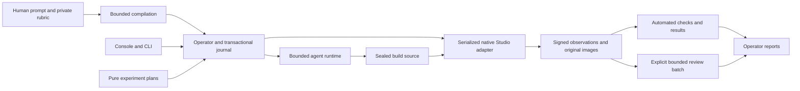

# Architecture

Basalt is a local application that accepts only loopback connections. The console and the
CLI call the same operator service. This service owns a SQLite journal, immutable
artifacts, the cumulative costs and one process driver for each run. Research controllers
plan and analyze work. They do not own execution.

## Package boundaries

| Package               | Responsibility                                                              |
| --------------------- | --------------------------------------------------------------------------- |
| `contracts`           | Canonical records, capability vocabulary, request types and response types  |
| `eval-authoring`      | Exact human inputs, compiler, coverage, reference builds and definitions    |
| `model-client`        | Replaceable one-turn transports, endpoint routes, preview costs and charges |
| `agent-runtime`       | Bounded orchestration of models and tools, and recoverable checkpoints      |
| `operator`            | API and CLI services, driver, authorization, evidence and review            |
| `artifact-store`      | Transactional journal, immutable files and sealed source                    |
| `studio-runner`       | Fixed native execution, signed acquisition and evidence ingestion           |
| `experiments`         | Pure frozen protocol plans, samples, aggregation and statistics             |
| `reporting`           | Pure build histories, line changes, ATIF trajectories and export files      |
| `graders`             | Local checks, source analysis, script origin and deterministic criteria     |
| `development`         | The public development tools of a builder and their saved results           |
| `task-registry`       | Discovery, validation and frozen copies of registered tasks                 |
| `luau-toolchain`      | Roblox type definitions for the Luau checks of plugin, fixtures and builds  |
| `cli`, `apps/console` | User entry points that use the shared services                              |

`tasks` and `studies` hold the evaluation prompts, the authored reference builds, the
rubrics and the frozen protocols. Generic harnesses do not import fixture
solutions or adapters for one mechanic. Provider SDK types stay outside the runtime and
the contracts. Executable dependency tests enforce these boundaries.

## Authored authority and preparation

The input module and the rubric document module of `eval-authoring` keep the exact text
and the hashes. They also keep the CommonMark/GFM structure, the inherited context and the
UTF-16 source spans. The authored catalog supplies the identity and the words of each
criterion. Planners select these identities. They cannot replace the meaning that a person
wrote with acceptance summaries that a model generated.

The compiler checks clause coverage, requiredness, scale and anchor fidelity, the
separation of public and private text, evidence references and supported capabilities.
Weights do not become score ranges. Setup does not become an extra criterion. An ambiguity
or an unsupported acquisition stays a diagnostic, and it can need an edit by a person.

Public preparation sees only the builder prompts of all stages and the public
configuration. It runs one time for an evaluation and returns one public scene and the
public task and development recipe of each stage. Code supplies the evaluation identity,
the title, the exact prompt of each stage and the seed fields. The private part runs one
time for each stage, with the place of the stage in `evaluationStage`. The
private part sees the rubric and the frozen public setup, and it has two stages. The plan
stage writes the private Studio plan and its sequence view. The plan must pass its own
checks before the criteria stage starts. The criteria stage then writes the criteria, the
mappings and the required capabilities against the frozen plan, and it cannot change the
plan. No private correction can write the public scene, the evaluation or the builder
instructions again. The public part and each private stage can get three corrections for
specific local validation errors. A large plan of a hard evaluation often needs more than
one.

A preparation starts from a base if one exists. The base is the most recently registered
evaluation with the same title and the same stage prompts. Basalt makes the public
preparation of the base again from its stage revisions, and it uses that preparation if it
passes the current public checks. A stage keeps the plan of its base stage if that plan
passes the current plan checks. Then the stage keeps the checks, the mappings and the
required capabilities of each unchanged authored criterion byte for byte. The mappings get
the criterion IDs and the spans of the new draft
([preparation-base.ts](../packages/eval-authoring/src/preparation-base.ts)). If this carried
proposal compiles, the stage needs no model request. If it does not compile, its compiler
diagnostics start the criteria stage, so the first request is a correction of the carried
proposal. If the criteria still do not compile after the corrections, the stage prepares a
new plan and new criteria. The quote covers both paths. The preparation receipt records
`reuse`: the base revision and, for each stage, `reused`, `fallback` or `prepared`, with the
number of carried and prepared criteria. Thus after a criterion edit, a recheck keeps the
public content and the plan. It checks the changed criteria again, and the other criteria of
each shared judge request that a change touches.

Before validation, code repairs only unambiguous errors of shape and records each repair
with the compiled attempt. For example, it canonicalizes IDs. It also removes a client that
leaves Play from the report contexts of its scenario, if no observation or binding reads
the reports of that client. The model role applies these repairs before its shape check, so
a repair also reaches output that the shape check would reject. The repaired submission is
the base of the next correction.

After compilation, an optional coverage model compares the prompt, the criteria and the
private plan in two directions. Each criterion entry has `evidenceFor` and
`evidenceAgainst` before its values. The values are a coverage (`matches`, `partial`,
`stricter` or `untested`), a prompt support (`stated`, `implied` or `unstated`) and
`mixesClasses`. Each private check, an executable criterion of the plan, gets a
`CheckCoverage`: `supports` with its criteria, `orphan`, or `unstated_in_public_contract`.

The tool `submit_coverage_notes` is strict. Eight criteria or fewer share one request with
the stage `coverage`. A larger set gets one request for each criterion, with the stage
`coverage:<criterion ID>`, and one request with the stage `coverage:checks`. The requests
run in parallel, and each stage has its own ledger requests. The preparation quote has one
bounded request for each, so a large set repeats the plan in each request.

The requests run in parallel with the registration. The notes are hypotheses for a person.
They never change the plan, the criteria or a launch. A failed request gives an incomplete
entry in `requests`, and the other requests keep their entries. The record of each revision
and coverage model is immutable, under `.basalt-evals/authoring/coverage-notes/`. The
builder and the judge never read it.

If a request is truncated, times out or has an uncertain result, the preparation stops.
Basalt does not automatically generate the output again. A correction of either part starts
from the last readable submission, also when that submission has shape errors. It sends one
to 32 edits with `submit_public_correction` or `submit_private_correction`, so the parts
that are already correct stay the same. Each edit path addresses that submission. Basalt
applies the edits from the last position to the first, so no edit moves the target of
another edit. An edit can replace a whole part or remove an extra top-level field. As in
JSON Patch, `add` and `replace` both set an object field. An edit
error names the edit and the length of its array. If Basalt cannot apply the edits, it keeps
the base and its errors, and it tells the model why. Otherwise the next diagnostics describe
only the new submission. Compiler diagnostics name their authored criterion. If a shape does not match any form of a
union, the error names only the closest form. The Studio plan validator checks each scenario on
its own, and the compiler runs each of its checks on its own. The evaluator check and the
private resolver check each criterion on its own, also when the plan has errors. Thus one correction gets the
errors of all scenarios and checks together. An unknown scene path error names every
unknown path and the paths that the neutral scene supplies. The role check names each
invalid role and each of its problems. Only an answer that Basalt cannot read gets a new
complete proposal. The corrected output must pass all the schema checks and the semantic
checks before compilation.

The shape diagnostics include sequence references that Basalt can check independently.
Thus an absent phase cannot hide a broken action binding until after the correction. Both
model tools describe the required presentation phase and use the same reference rules as
native execution. Sequence anchor IDs name capture windows. Action sources bind explicit
step IDs that are not wait steps, and state sources bind declared probes for the full
scenario. Signed assessments keep these anchor identities separate from the action step
IDs.

One authored rubric item gives one reported criterion, with all the observation bindings
that support it. Requests in the prompt that the rubric does not contain are context
without a score. Code checks the measurable facts that Basalt supports. Models interpret
qualitative evidence. Absent facts stay incomplete. A measurement window never adds a
deadline that the author did not write.

The rubric document reads `Evidence class:` lines, `Polarity:` lines and
`Insufficient evidence when` or `if` conditions as `grading_metadata` in their scope.
Metadata inside a `requirement` passage gets the role `unresolved`. A `requirement` passage
has a maximum of one class: `appearance`, `timing`, `motion` or `causality`. It also has
one polarity: `presence`, or `absence` from a `Polarity: absence` line.

The authority catalog shows the class and the polarity to the private preparer, and the
submission resolver copies them into each visual and categorical criterion. The compiler
rejects a changed class or polarity. It asks for a clarification when an `absence`
criterion has a score scale. It sends rendered frames only to `appearance` criteria. It
sends `timing`, `motion` and `causality` criteria only to engine rules, or to categorical
criteria with signed runtime facts and no frames. A judgment of rendered frames without a
class needs a clarification. An `absence` criterion cannot use anchor build pairs.

Each judge criterion carries its polarity in the request. The verdict enum of
`submit_judgment_batch` adds `present` and `absent` when the request has an `absence`
criterion. [batch-judgment.ts](../packages/eval-authoring/src/batch-judgment.ts) accepts
`present` and `absent` only for an `absence` criterion, and `satisfied` and `violated` only
for a `presence` criterion. It maps `present` to `violated` and `absent` to `satisfied`.
Each decision keeps the exact answer word in `answer`. `answerVerdict` in
[criterion-response.ts](../packages/eval-authoring/src/criterion-response.ts) is the one
rule, and `sampleVote` uses it too.

A compiled definition binds the exact authored inputs, the setup, the preparation model
and the compiler identity. Concurrent requests that match share one owned computation. A
completed definition is immutable, and all evaluated models can use it again. If the owner
is dead, only the original run can recover the saved requests. Basalt never sends a paid
request again if its response is unknown. If an edit changes only private text, Basalt can
use the public setup again.

Execution readiness, the discrimination of the reference test, automated outcomes and
human calibration stay separate. Compilation registers a definition that is ready to run,
and it marks the reference test as not run. An explicit reference test has its own preview
and its own run. Generated expectations stay hypotheses. A frozen research registration
needs its exact checked reference record and independent review gates.

[source-observation.ts](../packages/operator/src/source-observation.ts) observes one fixed
source with the private Studio plan of a revision. The source is a set of Luau files on the
seed, a set of Luau files on a registered parent source, or a registered source. The observation verifies the signed receipt and runs the code
checks of the revision. A complete receipt replays after an interruption, and Studio does
not run again. Only the empty build observes the seed with zero added files. Studio sees
the purpose `control` for each fixed source, so the runner treats them all the same. A
control of the reference test adds only the comparison with its expected outcomes.

[empty-build-check.ts](../packages/operator/src/empty-build-check.ts) observes the empty
build of each new revision after Basalt stages it. The check always runs, and a person
cannot turn it off. It runs the code checks of the revision and sends no model request. A required
code check with the outcome `verified` on the empty build is a plan warning. The check
runs in an owned computation, and each revision saves one record under
`.basalt-evals/authoring/empty-build-checks/<revision>/`. An error gives an incomplete
record, and the record never blocks the registration. The preparation receipt has one
entry in `stages` for each stage, with its revision, its coverage and `emptyBuild`. Only
stage 1 has an empty build check. The `emptyBuild` of a later stage is `not_applicable`,
because that stage starts from the build of the stage before it.

## Staged evaluations

The authoring input has `stages`: 1 to 6 objects with `prompt`, `rubric` and an optional
`gateCriterionIds`. `MAX_EVAL_STAGES` in
[working-copy.ts](../packages/contracts/src/working-copy.ts) holds the limit. The prompts of
the stages are different. [input.ts](../packages/eval-authoring/src/input.ts) parses the
criteria of each stage on its own, so an authored criterion ID is unique only in its stage.
A gate names required criteria of its own stage, in authored order, and the last stage has
no gate. The working copy of the editor holds the same stages.

Preparation compiles one `EvalRevision` for each stage. `revision.stage` holds the stage
number, the count, the earlier prompts, the authored gate and `nextRevisionId`. The store
writes the last stage first, because each revision names the next one. The revision of
stage 1 is the identity of the evaluation in the library and in the catalog.
`readStageRevisions` reads the chain from stage 1. The compiler refuses a gate criterion
without a required deterministic check, and `gateCheckIds` gives the executable checks of a
gate.

Registration saves a readiness record and a registered task for each stage. The records make
a chain in the same way: `nextRecordHash` names the record of the next stage, so
`registerStages` saves the last stage first. The record hash of stage 1 thus binds the record
of each stage, and the catalog holds only that hash. All records of one chain have the same
status, so a checked stage 1 means that each stage is checked. `stageRecordHashes` follows
the chain from a record. It reads no record for an evaluation without stages.

A selection run quotes and freezes one component for each stage, in stage order, under one
spending limit. The component of each stage binds the record of its stage in the chain from
the catalog. Each component is one `RunEvalReference` with `stage`: the revision of
stage 1, the stage number, the count, the earlier prompts and the executable gate checks.
Each `RunSubject` has `stageIndex` and `parentSubjectId`. The parent is the subject of the
stage before with the same model, tool set and repetition. The manifest check refuses a
stage list with a gap or out of order, a generated build of a later stage without a parent,
and a parent of another model or repetition.

A stage run (`kind: "stages"` in
[stage-run.ts](../packages/operator/src/stage-run.ts)) composes consecutive stages of one
staged evaluation from saved builds. It names the revision of stage 1 and has one eval quote
for each stage that it holds. Only its first stage starts from saved sources, so that stage
can be a later stage. Each later stage must use the record that the record of the stage
before names. A saved build of a later stage holds the work of the earlier stages, so a
replay of it needs no earlier build.

[stage-reach.ts](../packages/operator/src/stage-reach.ts) decides the reach of a build:

- `reached`: stage 1, or a completed parent whose gate checks all have the outcome
  `verified`.
- `waiting`: the parent build or a gate check has no result yet.
- `not_reached`: the parent failed, is incomplete or is not reached, or a gate check, its
  observation or its grading did not pass.

The scheduler starts only reached builds. The driver records a build that is not reached as
`not_dispatched` with the reason `stage_not_reached` and starts no model work. Replay accepts
that event only when the stage is not reached, and it refuses a later event of that build.
A builder start needs the completed parent and its completed gate checks. The unit summaries
count the units of these builds in `notReached`, and the measurement leaves them out. The
journey projection counts these builds in `notReachedCandidates`, and its `plannedCaptures`
leaves out their observations.
`notReachedCause` names the parent and its failed gate checks. `notReachedSummary` in
[catalog-projection.ts](../packages/operator/src/catalog-projection.ts) gives the parent
title, its stage and the cell and observation of each failed gate check. The result summary
and the evidence candidate carry it as `notReached`, so the console links to the gate check.

[builder-stage.ts](../packages/operator/src/builder-stage.ts) publishes the sealed candidate
of the parent into the workspace of a later build. `sealedParentBuild` verifies the
completed event, the saved run and the sealed files first. The build starts a new
conversation. The `{{stages}}` slot lists the earlier prompts. Replay and public development
replay of a saved build of a staged evaluation quote a stage run of its stage. A repair of
such a build quotes a stage run from its stage through the last stage. The repaired stage
keeps the record of the original run, and each later stage uses the record that it names.
Each later build continues the repair build of its own repetition, and the gate of each stage
applies as in a selection run. Rechecks and known builds pair a build with the same stage of a version.

A reference test of a staged evaluation has one quote and one ledger for every stage, and
[prepare-controls.ts](../packages/operator/src/prepare-controls.ts) runs the stages in stage
order. A later stage starts only from the checked working control of the stage before, and
only when that control has the outcome `verified` on each gate check of that stage. Basalt
registers that control as a source with the kind `control`. Each control of the later stage
is a set of Luau files on that parent source. Its control-source request also has
`earlierPrompts` and `startingFiles`, the Luau files of the parent. Only a later stage adds
this material, so the requests of stage 1 keep their bytes. A pinned hash in
`control-request.test.ts` holds the requests and the quote of an evaluation without stages.
A stage that the test does not reach sends no request. The result has one entry in `stages`
for each stage, with `reached`, `parentSourceId`, `gate` and the result of the stage. When
every stage is checked, `checkedStageRecord` gives the checked record of each stage, and
`registerStages` saves the chain. The test puts the record of stage 1 into the catalog. The
result then has that record as `validationRecordHash`. A test that does not check every stage
saves no checked record. The evaluation page reads the chain and shows the reference controls
of each stage.

The benchmark report has one evaluation for each stage, with `stage` and the title
`Title · Stage 2 of 3`. Each build has `parentSubjectId` and `notReached`. The attempts of a
build that is not reached have the outcome `not_reached`, and the success bounds leave them
out. Exports carry the stage of each evaluation.

[plan-warnings.ts](../packages/experiments/src/plan-warnings.ts) is pure.
`criterionWarnings(rows, minimumBuilds = 2)` reads one row for each answer: an observation
of a generated build, the empty build or a known build. The kinds for every build need at
least two generated builds, and only met or not met answers. A check that every build fails
with one observed value gets `same_observed_failure`, and otherwise `every_build_fails`. A
met answer of the empty build gives `passes_empty_build`. A definite code or judge answer of
a known build that differs from its mark gives `known_build_disagrees`.
[plan-warnings.ts](../packages/operator/src/plan-warnings.ts) collects the warnings of one
revision across all of its benchmark runs, its empty build check and its known build gate.

[failure-explanation.ts](../packages/operator/src/failure-explanation.ts) runs Explain
failures. The `explain_failures` launch intent makes a free preview. The preview freezes the
material under `.basalt-evals/authoring/failure-explanations/inputs/<id>.json`: the
questions of `studies/failure-questions.md`, the builder prompt, the public roles, the
Studio plan, and for each flagged criterion its private check and the saved observations
of up to three builds. The saved observations are the answers, observed values and reasons
of the grading cells and the judge samples, after Basalt compares their hashes with the
journal. The quote binds that material as its subject.

The authoring stage `explanation` sends the one request with the stage name `explanation`,
so the driver does not change.
[failure-explanation-request.ts](../packages/eval-authoring/src/failure-explanation-request.ts)
builds the request with the strict tool `submit_failure_hypotheses`, and
[failure-explanation.ts](../packages/agent-runtime/src/failure-explanation.ts) reads the
answers. An answer that names an unknown observation ID is incomplete. The record is saved
under `.basalt-evals/authoring/failure-explanations/<revision>/<run>.json`. The driver does
not check Studio readiness for this stage, because it reads only saved evidence.
The known build gate runs in the same hook, beside the empty build check, with the revision
of stage 1. It also never blocks the registration. It blocks only a new benchmark of the revision, and the receipt
has `knownBuilds` with the status of each known build. Refer to
[Suites, reassessment, and comparisons](#suites-reassessment-and-comparisons). A fixed
source has one of three purposes: `control`, `empty_build` or `known_build`.

The preparation parity study measures how often a prepared private plan answers differently
from a curated plan. [curated-revision.ts](../packages/eval-authoring/src/curated-revision.ts)
compiles the task files of one task with a rubric and a criteria map that a person wrote.
Each pilot task has `rubric.md` and `criteria-map.json` as drafts for a person. The compile
refuses a file with the draft line or a map without the status `approved`. Each mapped
private check reads the exact text of its rubric criterion.
[parity-study.ts](../packages/operator/src/parity-study.ts) saves the curated public part
for the context of each preparation model with the provenance `curated`. Thus each model
writes only the private stages for the same public contract. A public part that a model
wrote has the provenance `model`. The saved study builds then run under each plan with code
checks only and two observations each.
[preparation-parity.ts](../packages/experiments/src/preparation-parity.ts) pairs the answers
by authored criterion and source hash, never by evaluation identity. It gives the
disagreement count of each model, the noise floor inside each plan, and the insufficient and
unstable pairs apart from the rate. A disagreement does not show which plan is correct.

## Execution limits and readiness

After authorization, readiness first runs the read-only preflight of the Studio adapter. A
failed check stops the start with `studio_setup_incomplete`, and its explanation names each
cause. The preflight never starts Studio. Then a canary uses an actual Studio worker, the
fixed neutral scene, Play and the connector. It also uses a known fact about the Ground part and an
image. A successful signed receipt is valid for ten minutes. It binds the identities of
Studio, the connector, the runner and the account. A changed identity makes the receipt
invalid. A preview does no Studio work.

If the startup or the capture fails, Basalt blocks the paid preparation and keeps the
actual classification of the failure. An interrupted canary reconciles the native attempt
that it owns. Only another explicit launch or resume can try a signed terminal failure
again.

The preparation, build and judge stages have no limit on elapsed time and no timeout for
each request. Basalt only records elapsed time. The spending limit, the turns, the output
size, the runaway stop of the transport and an explicit Stop set the limits of model work.
A cancellation keeps the full pending charge of each uncertain request. Basalt keeps a late
response for reconciliation, and it does not send the request again.

Studio watchdogs come from the scenario duration and from the allowances for startup and
acquisition. The three-minute limit of the canary includes the preparation of its isolated
place. This limit detects startup failures of the infrastructure.

The preview freezes a set of endpoints for each model, not one endpoint. The set holds each
endpoint that accepts the tools, the images and the context of the work, in one service
tier. Basalt does not filter the endpoints by price, weight precision, speed or data policy.
Basalt does not use Flex unless a person selects it explicitly. It uses priority endpoints
only for a model without endpoints in the default tier.
OpenRouter routing can serve a request in another tier, for example `provisioned`. The
answer stays valid. The response facts record the requested tier and the served tier, and
the ledger checks the charge as for every request.

OpenRouter picks the endpoint of each request with its default routing. The request sends
no endpoint list and no sort, and provider fallback is on. The default routing prefers
endpoints without a recent outage, and it weights them by the inverse square of the price.
The account settings of OpenRouter, for example its data policy, also apply.

The request carries the highest price of the set as `max_price`, and the reservation uses
that price. Thus the charge of a request cannot be more than its reservation, and no catalog
read is necessary between the preview and a request. Each request stays inside the
smallest limits of its set. Each receipt records the provider that served the request. One
launch runs a maximum of five independent generations for each model, harness and
evaluation.

The output allowance of each model request is the smallest limit that the providers set for
the frozen endpoint set. This rule applies to builder turns, judge requests, reference checks,
reassessments, preparation and research. Basalt adds no output limit and no reasoning
token limit of its own. Thus no model stops at a Basalt constant that another model does
not reach. A judge request keeps an advertised reasoning effort or the provider default.
Previews, execution requests and review treatment identities include the allowance, and
each request reserves the cost of its full allowance. Basalt keeps a response continuation
of up to 8 MiB. Measured responses used up to 13 bytes for each output token, so this limit
holds more than 600,000 output tokens.

A builder conversation grows with each turn. If the input bound of a builder request leaves
less context than the output limit, the request uses the remaining context. Thus a long build
does not stop at an endpoint with an output limit near its context length. The input bound
counts one token for each byte, and images use their image token rule. The builder quote uses
the costliest split of input and output that fits the context. A split can start a price tier.

The OpenRouter provider of the AI SDK puts the reasoning details of a response on its first
tool call and on each reasoning part. The next request reads only the copy on the tool call. A
continuation keeps only the two copies that the next OpenRouter request carries. OpenRouter
sends one copy to the provider, so the input bound stays an upper bound.

The transport receives each response as a stream of server-sent events. It reads the stream
to the end and makes the same result as from a complete response. A tap reads each event
before the SDK reads it. The tap gives the generation ID of the first event to the dispatch
observer at once. Thus a stop or a crash during a stream keeps the ID for a billing read. The
HTTP agent keeps its settings, so a quiet stream has no response cutoff.

The SDK adapter parses all of the arguments of a tool call again after each delta, until they
parse. Thus the tap joins consecutive argument deltas of one call into one event, and the cost
stays linear. A group ends at the delta that closes the first JSON value, so the adapter finds
the complete call at the same delta as before. A delta with other content is not joined.

The tap stops a stream if one run of whitespace becomes longer than 4,096 characters.
It counts each run in the text, and separately in the arguments of each tool call. A finished
JSON value never needs such a run. The transport descriptor records the limit as
`runawayWhitespaceStop`, because it changes execution. The result of the stop is a provider
failure with the class `runaway_output`. Basalt does not send the request again. The stop is
not an output limit, and the request keeps the output allowance of its endpoint set. A Stop of
the caller stays a separate `cancelled` result.

A tool definition can declare `strict: true`. The transport then sends that tool in strict
mode, with a wire schema from one fixed, pure transform of the declared schema. The transform
changes `oneOf` to `anyOf` and `const` to an `enum` with one value. It removes the constraints
that strict mode does not accept, for example `minItems`, `maximum`, `pattern` and `format`.
It writes each removed bound into the description of its field as a fixed sentence, for
example "The value is 0 or more.", so the model still knows the bound. A note such as `default`
or `title` does not go into the description. The local validators keep the complete declared
schema. A tool without the marker goes out
with `strict: false` and its declared schema. The descriptor records this rule as
`toolSchemaMode: "declared_per_tool"`. The three preparation proposal tools are strict: the
public proposal, the private plan and the private criteria. A correction tool is not strict,
because an edit value can be any JSON. If a runaway stop has a known charge, preparation
treats it as an unreadable answer and continues. If its charge is unknown, preparation stops.

The transform refuses a strict schema that strict mode cannot express. The refusal is a
`request_configuration` failure before dispatch, and its message names the schema location.
These schemas are refused:

- An object without `additionalProperties: false`.
- An object with a property that is not in `required`.
- An empty schema, or a schema without `type`, `enum` or `anyOf`.
- A keyword that strict mode does not accept, for example `allOf` or `$ref`.
- A schema beyond the published OpenAI limits: 10 levels of object nesting, 5,000 object
  properties and 1,000 enum values.

The reasoning and the answer share this one allowance. No provider guarantees a division
between them. Anthropic thinking budgets are targets, newer Claude models reject a manual
budget, and router effort ratios change with the output limit. Thus a judge response can
stop at the limit with no answer (`reasoning_exhausted`) or after its answer started
(`answer_truncated`). `outputLimitCut` in `model-client/output-limit.ts` is the one
classifier of these kinds. Both stay incomplete and go to review with the original charge and
receipt. Neither becomes a judge answer or a retry.

Before any cost, the judge request factory refuses an endpoint if its output limit cannot
hold the longest answer of its tool schema. The factory counts one token for each
character of that answer. This is a Basalt admission rule, not a provider guarantee.

The `submit_observations` tool admits 32 `observations` and 16 `limitations` of
500 characters each. Each entry names 64 frame IDs or fewer. Thus its longest answer for
64 frames is 47,701 characters, less than half of a 128k output limit. The
`submit_judgment_batch` tool admits a `rationale` of 800 characters for each criterion,
and a rubric has 64 criteria or fewer. Its guard report adds a quote of 300 characters.
Thus its longest answer for 64 scored criteria is 60,720 characters, also less than half
of a 128k output limit.

The frozen judge identity also binds the sampling parameters. The model snapshot freezes
the `default_parameters` recommendation of the catalog, with null for each parameter that
the recommendation does not state. A judge request sends each recommended value that all
endpoints of the set accept, and it records null for the others, which keep the provider
default. Basalt never supplies a sampling value of its own. The transport sends the seed
if all endpoints of the set accept it. It sends the seed modulo 2^31, because Google Vertex
accepts only a signed 32-bit seed. A seed is not a guarantee, and it does not make a judgment
reproducible.

Image tokens use one rule for each model family. Each rule comes from the official
provider documents ([image-tokens.ts](../packages/model-client/src/image-tokens.ts)):

- Claude: 28 px patches after the documented resize.
- OpenAI: the patch and tile rules for the listed models.
- Gemini: tiles and media resolution.
- Qwen VL: patches.
- DeepSeek: the bound for each image.
- MiMo: its own calculation.

Each rule is a conservative upper bound. If a model has no documented rule, it reserves
all the prompt capacity that is left for its images. The billed usage stays the authority.

All stages share one spending limit. Each actual request reserves only its own maximum
cost, and this cost must fit in the cumulative spending limit. Basalt does not reserve the
theoretical maximum of a workload before the work starts. Concurrent units share the
limit: [Concurrent units of a run](#concurrent-units-of-a-run) gives the rules. If the next
request of a build or a judgment cannot fit, that work pauses until the spending limit
increases.

Builds share the frozen public evaluation, environment, tools and declared resource
policy. The costs of preparation and judgment are separate from the execution cost of a
build. All requested builds and judgments stay in the planned denominators.

## Concurrent units of a run

One driver process runs the units of a run at the same time. A unit is a build, a seal of a
saved build, an observation, a deterministic check, a judgment batch, a gate or the
report. [run-scheduler.ts](../packages/operator/src/run-scheduler.ts) selects the units that
can start. It reads the status again each time that a unit ends. The run finishes when the
report completes. The Studio workers file names one or more worker accounts, and each
worker owns its own lanes.

The scheduler starts units in this sequence:

1. Units that an earlier process left in flight. Their own code reconciles the saved work.
2. Paused judgments and builds after a new authorization raised the limit, and provider
   pauses after a Resume, judgments first.
3. The judgments and deterministic checks of each completed observation.
4. The observations of each completed build, and the seals of saved builds.
5. New builds, round-robin across the models. Work that paused at the unchanged limit keeps
   new builds from starting.
6. The report, only when no unit runs, every build started and no unit is paused.

A provider hold keeps each paused, new or waiting build and judgment of its scope from
starting. The next section gives the rules of provider pauses and holds.

`RUN_CONCURRENCY` in
[execution-limits.ts](../packages/contracts/src/execution-limits.ts) limits the builds to
four and the judgment batches to six at the same time. Model turns of builds and judgment
requests are network work, so they overlap. A judgment starts when its observation
completes. It does not wait for the next build, and the next build does not wait for it. A
gate or the report runs alone: it starts only when no other unit is in flight, and no unit
starts beside it.

The next new build comes from the model with the fewest builds that run. If two models have
the same number, the model with the fewer started builds goes first, then the model that
comes first in the run. Thus one model cannot fill all the builder slots.

`RUN_CONCURRENCY` limits the units of each stage. The frozen `modelConcurrency` of the
manifest limits the requests of each model. The driver makes one `ModelPermits` for the run
([model-permits.ts](../packages/operator/src/model-permits.ts)), with one first-in, first-out
line for each model. The builds and the judgments of a model share its line. The
`BoundedModelClient` of a unit takes a permit before `ledger.reserve` and gives it back when
the result settles. A replay of saved files takes no permit. A rate-limit wait, a tool call
and a Studio job come between two requests, so they hold no permit. The limit applies to one
run. Two runs that use the same model each have their own permits.

The request check finds a provider hold before the permit, so a held request never waits for
a permit. A request that waited for its permit makes the admission check again before its
reservation, because another unit can pause the run during the wait. If a hold exists then,
the request gives the permit back and the unit pauses with the record of the hold.

Studio jobs overlap only up to the number of Studio lanes. The public `development.run` of a
build and the final observation both use the native Studio worker. The driver puts their
admission through one Studio queue of the run. The queue admits one Studio job for each
lane at the same time. The number of lanes is the sum of the lanes of all workers in the
Studio workers file.

A development run goes before each final observation that waits, because a build waits for
its result. Inside each purpose, the queue keeps the arrival sequence. After the queue
admits a job, the job also claims a native lane, which limits Studio work across processes.
The driver shows "Waiting for Studio" only while a job waits for a lane that another run
holds.

The event chain keeps `inFlightUnits`, a list in start sequence, so several units can be in
flight at the same time. Replay accepts overlapping starts of builds, seals, observations, checks and
judgments. It refuses a second start of a unit, and it refuses any overlap with a gate or
the report. Appends of one operation in the driver process run one at a time. If another
process appends first, for example a Stop from the console, the append reads the chain
again and makes all its checks again.

Each reservation is one journal transaction, so concurrent reservations cannot overspend
the limit. A bounded client holds its request from the reservation until it knows the
charge or gives the request up. The hold is local to the driver process. A pending entry
that a live client holds does not block other units. A pending entry without a holder
blocks every new paid dispatch until a reconciliation. A client settles its charge before it
releases its hold, so an older ledger state can show a settled request without a holder.
Thus each check reads the ledger and the holds in one synchronous step. If a request fits
only after held requests settle, its reservation waits for them. Reservations wait in arrival
sequence, so a large request is not starved. If the request cannot fit when all held
requests settle, the reservation fails, and the unit pauses. A paused unit records the hash
of the spending authorizations. Charges of other units do not change that hash, so only a
new authorization resumes the unit.

Stop aborts all units. A wait in the Studio queue, in the line of a model permit or in the
reservation sequence ends, and the unit records nothing. A dispatched request keeps its full
pending charge. Each interrupted unit stays in flight, and Resume reconciles it first. A
failure that stops the run drains it instead: no new unit starts, the Studio queue refuses
new jobs, and each build or judgment stops before its next request. A Studio job that runs
continues to its signed receipt. Then the driver reports the first failure. A failure that
stops the run is a failure of an observation, an infrastructure fault, an unknown charge, a
unit that stays in flight or a unit that recorded no outcome. A retained failed build or
check stays in its denominator, and the other units continue.

A provider failure of the account, of a model or a persistent provider failure pauses its
unit. The runtime records the rejected request as a `provider_paused` response, which is a
call without a turn. It saves the `before_model` checkpoint and throws
`AgentProviderPaused`. A judgment throws `ProviderPauseError` with its request ordinal. The
operator saves a `PauseRecord` with the scope, the dependency, the error class, the failure
record and the ordinal. Then it appends a `provider_paused` event that binds the hash of the
record. Replay accepts this event only for a build or a judgment with one hash, and it
releases the attempt of the unit.

The provider pauses after the last `resumed` event make holds. An account pause holds each
build and judgment. A model pause, or two persistent pauses with the same dependency, hold
the builds and judgments of that model (`unitModelId`). The scheduler and the request
checks of the builder and the judgment read the same holds from the event chain, so the
holds survive a crash. A request check finds a hold before the reservation and throws
`ProviderHoldError`. The held unit records a `provider_hold` response without a call, and
it pauses with the record of the hold. A request that reserved its charge before the pause
continues.

Only a later `resumed` event admits a provider pause again. A higher spending limit does
not. Resume stays available while a provider pause exists. A resumed build continues the
same turn as the next request ordinal of its stage. A resumed judgment acknowledges the
ordinals of its saved pausing failures. Its client then sends the next ordinal and does not
replay the saved failure. Each unit gets at most 8 provider pauses. After that, the next
pausing failure ends the unit as incomplete. If only provider pauses stop the run, the
driver reports the cause in one sentence, and the workflow needs attention.

After a crash, the new process holds no request. Thus every pending entry blocks paid
dispatch until Check payment status reconciles it. Basalt never sends such a request again.
A build in flight continues from its checkpoint, and a judgment in flight continues from
its saved receipts.

The journey projection shows one activity for each unit in flight, with the model and the
start time of the unit. The timeline marks each step from the earliest unfinished step to
the latest active step as current. If no unit is in flight, for example between two units
or while Basalt writes the report, the latest step with completed work stays reached and
its title is the action. The steps before it stay finished. The benchmark report lists all
active units.

[build-stop.ts](../packages/operator/src/build-stop.ts) says why a build stopped.
`buildStopText` reads only the stop reason, the failure detail, the count of
`tool_rejection` events, the tool count of the last `model_response` and the failed checks
of the last `gate`. It quotes at most 200 characters. `savedBuildStop` reads the saved
`agent-run.json` of a failed or incomplete builder event, only when the event records its
hash. Activity events and the operation view carry the text as `buildStop`. The view
finds the newest incomplete builder event in the activity index, so earlier runs show the
text too.

## Fixed Studio execution and evidence

Plans are canonical JSON. Fixed TypeScript and Luau code interprets them. Basalt accepts
no generated runner code, arbitrary expressions, callbacks or generic property access.
Public semantic roles resolve by their id, which is also the CollectionService tag of the object, and by the class, the scope and the cardinality. Literal paths can
point only to declared neutral objects and to `game.Players.LocalPlayer`. A LocalPlayer path
reads a Player attribute, or the presence or name of a Player-owned object such as a
leaderstats value. The `instance_value` observation reads the `Value` of an IntValue, a
NumberValue, a BoolValue or a StringValue, and of no other class. A LocalPlayer path is
valid only in the client context of an actor, because the server has no LocalPlayer.

The capability catalog supports bounded GUI and key input, movement, multiplayer,
replication, remote input, physical passage, motion, support, times and captures. Basalt
records an absent binding, an ambiguous binding or a binding in the wrong scope as an
explicit result. An absent value cannot pass a comparison with false or zero. An input
receipt proves an attempt of input, not its causal effect.

The `performance_trace` observation runs only in the server context of a scenario. It takes
`sampleCount` samples, one after each `intervalMs` of at least 250 ms, so its window is
`sampleCount × intervalMs`. Each sample covers the interval since the sample before it. It
records the measured time, the count of `RunService.Heartbeat` frames, their mean and
maximum frame time, `Stats.InstanceCount` and `Stats:GetTotalMemoryUsageMb()`. If Studio
refuses the first read of a Stats value, every sample leaves out that value, because Luau
cannot send JSON null. A later refusal stops the trace as incomplete. The Studio runner
refuses a trace with fewer samples than the plan or with a shorter interval.

The `gui_layout` observation runs in a client context: in a phase, or in the scenario context
of an actor. Its path is a `ScreenGui` role with the `local_player_gui` scope or a
`game.Players.LocalPlayer.PlayerGui.<name>` path. [GuiLayout.luau](../plugin/src/GuiLayout.luau)
reads a fixed set of properties. It records the rectangle of the ScreenGui,
`GuiService:GetGuiInset()`, the camera `ViewportSize` and `IgnoreGuiInset`. It also records
at most 256 visible GuiObjects of that ScreenGui in path order. Each element has its
rectangle, its rectangle inside the ancestors with `ClipsDescendants`, its `ZIndex` and the
text fit of a text object. The observation records no text. If the limit leaves out an
element, `complete` is false.

`ScreenGui` is a role class. A ScreenGui is not a GuiObject, so a ScreenGui role needs the
`local_player_gui` scope. It cannot bind GUI input or a `gui_visible` anchor.

The engine rule `gui_layout_holds` binds one `gui_layout` fact and names one fixed check.
[gui-layout.ts](../packages/graders/src/gui-layout.ts) grades it. The rule waits for the
connector spike. Thus it is in `SPIKE_PENDING_RULES` of
[capabilities.ts](../packages/contracts/src/capabilities.ts), and not in the catalog or the
tool schema. Preparation cannot map a criterion to it. A plan that a person writes can use it.

The checks read the elements of the observation in GUI pixels:

- `on_screen`: each element that shows an area lies inside the viewport. A viewport pixel is
  a GUI pixel plus the GUI inset, for both values of `IgnoreGuiInset`. The spike checks this
  formula.
- `no_text_overlap`: no two text elements that show an area have a common area. An element
  and its ancestor are not a pair. The path prefix identifies the ancestor.
- `text_fits`: each text element has `textFits` true. This is also the rule for a
  `TextScaled` element.
- `min_text_px`: each text element has a `textSize` of at least `minimum.value`. A
  `TextScaled` element is undecided, because its `TextSize` does not give the rendered size.

An element shows an area when its `clippedRect` has a width and a height above 0. Basalt
ignores a difference of 0.01 GUI px or less, because Studio rounds its numbers. Only
`min_text_px` has a `minimum`, which is an authored bound in px. The other checks have
`minimum` null.

An absent fact or `exists` false makes the check `incomplete`. Then one known offender makes
it `rejected`, also when `complete` is false. The explanation names the first five offenders
and their values. Without an offender, `complete` false or an undecided element makes the
check `incomplete`. Otherwise the check is `verified`.

Three more engine rules wait for the same spike. They are also in `SPIKE_PENDING_RULES`, and
not in the catalog or the tool schema. Each rule has authored bounds.

The rule `performance_within` binds one `performance_trace` fact of a scenario step. It names
a `metric`, an `aggregate` and a `maximum`.
[performance.ts](../packages/graders/src/performance.ts) grades it.

| `metric`         | Sample field    | Unit of `maximum` |
| ---------------- | --------------- | ----------------- |
| `max_frame_ms`   | `maxFrameMs`    | `ms`              |
| `mean_frame_ms`  | `meanFrameMs`   | `ms`              |
| `instance_count` | `instanceCount` | `count`           |
| `memory_mb`      | `memoryMb`      | `mb`              |

The aggregates are `max`, `p95` and `growth`. `p95` is the nearest rank: the value at rank
`ceil(0.95 × n)` of the sorted samples. `growth` is the last sample minus the first sample,
rounded to 6 decimals. `memoryMb` is the memory of the whole Studio process, so the rule
validator refuses `memory_mb` with an aggregate other than `growth`.

An absent fact, a trace with fewer samples than `sampleCount` of the plan or a field that
Studio did not let the runner read makes the check `incomplete`. If the aggregate is at most
`maximum.value`, the check is `verified`. Otherwise it is `rejected`. The check records the
aggregate and the count of samples in `observed`.

The rules `capture_text_contrast` and `capture_exposure` read the pixels of one phase
capture. [frame-measures.ts](../packages/graders/src/frame-measures.ts) has the pure
measures. The measures use the WCAG relative luminance of each pixel: the Rec. 709 weighted
sum of linear sRGB values, from 0 to 1.

- `textContrast` splits the luminance of a rectangle into two clusters with the Otsu method.
  The ratio is `(Lhigh + 0.05) / (Llow + 0.05)` for the medians of the two clusters. If the
  smaller cluster has less than 2% of the pixels, the ratio is 1.
- `exposure` gives the mean luminance, the share of pixels below 0.02 (dark clipped) and the
  share of pixels above 0.98 (bright clipped).

`capture_text_contrast` names a capture and a `gui_layout` fact of the same phase. Its
`minimum` is a ratio `N:1` from 1 to 21. The check measures each text element that shows an
area. `guiRectInCapture` maps the `clippedRect` of the element to capture pixels:
`(GUI px + GUI inset) × capture width / viewport width`. This formula is question S3 of the
connector spike, so it is in one function. Each edge goes to the nearest pixel, and the frame
clips the rectangle.

The element must also be visible with the same path in the `sceneText` of the capture. If
not, or if no pixel of the element is in the frame, the element is undecided. The verdict
rules are the same as for a GUI layout check. The check records the count of checked
elements, of offenders and of undecided elements, and the lowest measured ratio.

`capture_exposure` names a capture, a `measure` and a `minimum`, a `maximum` or both. Each
bound is a percent from 0 to 100. The value of `mean_luminance` is a percent of white
luminance. The value of `dark_share` or `bright_share` is a percent of the pixels. The check
records the value in `observed`.

`evaluateDeterministicCriteria` takes `evidenceDirectory`, the directory of `evidence.json`.
A pixel rule reads the capture file in that directory and checks its hash against the
evidence. A different hash or different dimensions stop the grade of all criteria.
`decodeCaptureImage` of [images.ts](../packages/studio-runner/src/images.ts) decodes the
bytes, so `graders` imports this decoder. Each caller that grades signed evidence gives the
directory. Without a directory, a folder of the capture file or a capture file, a pixel rule
is `incomplete`. The safe read refuses an absent folder with an error, so the rule looks for
the folder first.

Each code check result records in `observed` the Studio values that its rule read. A fact
rule records one value, a delta rule records the value before and after, and a
cross-context rule records one value for each context. A timed step records the latency of
its first sighting.

A lint check records the count of each named code. A build error check records the counts
of build, unknown and external errors. A GUI layout check records the counts of checked,
offending and undecided elements. An offender of `no_text_overlap` is a pair. The records of
the performance check and the pixel checks are in their sections above. A source check,
a judge check, a human score and a check that read no value record null. A text of more than
256 characters is stored as `sha256:` and its hash.

The native adapter does one job for each Studio lane at a time. Each lane belongs to one
Studio worker, a separate macOS login. The host file `.basalt-evals/native-worker/workers.json`
([workers.ts](../packages/studio-runner/src/workers.ts)) names each worker: its account, SSH
key, Node, lanes, `maxClients` and `screenRecording`. Lane numbers are global from 0 to 3, and
the lanes of two workers never overlap. A job runs on the worker of its lane. The adapter
prepares isolated places from sealed source and verifies the configured connector bytes. It accepts only a
signed receipt whose session hash, source hash and artifact hash match. Public development
and the independent final evaluation use separate prepared places. A cancellation is bound
to the owned session. A disconnected SSH connection does not prove that the session
stopped.

Stop uses a separate read-only recovery signal. With this signal, Stop waits for the
signed terminal receipt and imports it. The worker publishes that receipt atomically after
its artifacts and its report. An import publishes complete files and does not replace
immutable inputs. Bounded transfer batches keep the signed membership and the directory
structure.

The adapter gives `capabilities()`: the macOS version and build, the hardware model and the
GPUs of this Mac, and for each worker its lanes, `maxClients`, capture method, screen
recording and golden template hash. The workers use SSH to 127.0.0.1, so Basalt reads the
host facts on this Mac. It keeps the GPU list for one boot. The environment hash of the
Studio identity binds the workers, the capabilities, the runner hash and the public key.
The capabilities hold the recorded template hash of each worker, never a value of one job, so
the hash stays stable between jobs. A job can take any slot. Thus the launch preview refuses
a plan with more clients than the smallest `maxClients` of the workers.

The adapter also gives a read-only `preflight()`. It checks the workers file, the Studio
version, the installed connector and the lane folders. For each worker, it checks the SSH
account, Node, the plugin folder of Studio and its connector bytes,
`ApplePersistenceIgnoreState`, the golden template and the GUI login session
(`launchctl print gui/<uid>`). It returns one sentence for each failed check, and it never
starts Studio. Settings, Recheck setup and readiness run it.

Each lane owns one directory below `.basalt-evals/native-worker/lanes`. Short journal
transactions claim and release the lanes. A new job claims the first free lane. A session
holds at most one lane: a dead, undispatched claim of the same session goes first. Lane n
uses the connector port 43123 + n, and the place of the job holds that port. Thus a job
prepares its session only after admission. A prepared session can use only the lane of its
port.

The jobs of all lanes share the CPU and the memory of this Mac, so
[lane-headroom.ts](../packages/studio-runner/src/lane-headroom.ts) admits a lane beside a held
lane only with headroom. The first lane needs no headroom, so a busy Mac still runs one lane,
and a refused job takes a lane as soon as no other lane is held. For a lane beside a held lane,
all of these conditions must be true:

- No StudioMCP of the controller account runs, for example for a Studio session of the person.
  The paragraphs about the Studio MCP anchor below give the reason.
- The free memory (`kern.memorystatus_level` of `hw.memsize`) holds the largest recent
  footprint and a reserve of one tenth of the memory.
- The idle CPU in a sample of 2 s holds the largest recent CPU use of a job and a reserve of
  one tenth of the cores. The load average of macOS also counts threads that use no CPU, so
  Basalt does not use it.

Without a measured footprint, or when the machine cannot be read, no second lane starts. A
refused claim waits like a busy lane. The worker measures each Studio start: the largest sum of
the resident memory and the mean sum of the CPU use of its owned processes in the process
scans. It writes `footprint.json` in its job folder, outside the signed `studio` folder,
because the footprint is an operational measurement and not evidence. After the receipt
import, the controller keeps the footprints of the last 10 jobs in
`.basalt-evals/native-worker/footprints/`. An absent or bad file leaves the job without a
measured footprint.

The claim `owner.json` holds the worker, the process ID, the session, the lane, `claimedAt`,
`renewedAt` and `leaseMs` (60 s). The holder renews `renewedAt` every 20 s with an atomic
replacement inside the lane transaction. The remote worker writes `lease.json` in its job
folder every 10 s, beside the signed `studio` folder: the worker process ID and process group,
the Studio process IDs, the place argument and `renewedAt`.

A wait for a lane can take back the lane of a dispatched job only if all these conditions
are true:

- The process of the claim does not run.
- The claim lease is older than its `leaseMs`.
- The SSH probe of the worker succeeds.
- The remote job lease is older than 30 s, or absent.
- No account process has the process group of the worker or a command line with the job
  folder.
- The worker published no `native/manifest.json`. If it did, Resume reconciles the receipt.

The probe runs outside the journal transaction. The removal then checks that the claim did
not change. Any probe error keeps the lane. When Basalt takes a lane back, it writes
`lane-release.json` beside the session, and the observation stays dispatched.
Reconciliation then finds the release record and refuses a remote import. Resume records
the observation as incomplete with the cause `studio_job_lost`. A lost readiness canary
records a new attempt, so the next readiness check starts a new canary. Basalt never stops a
process to take back a lane.

Before a development run waits for Studio, Rojo builds the place of the candidate in a
temporary folder. A candidate fault fails at once and never holds a Studio turn or a lane.
There are three candidate faults: Rojo ends with a non-zero exit code, the project root is not
a `DataModel`, or an instance has the reserved name `BasaltEvalBootstrap`. The builder gets the cause as the
tool result, also after a resume, because the same candidate gives the same failure. A fault
of the host, for example an absent Rojo, a timeout or a stop, is an interruption.

Reconciliation is idempotent. It can release only the lane of the session that matches,
also after a crash between the local receipt publication and the ownership cleanup. A dead
owner releases its lane at once only before remote dispatch. A dispatched owner is uncertain,
and only the lost-job rule above takes its lane back. A readiness check takes any free lane, but it does not wait: if each lane
is busy, it reports a busy Studio at once. Uncertain work that Basalt already sent cannot
start.

The `final_capture` stage, the public `development.run` and the Studio runs of reference
builds wait for the lane before Studio starts. In a run, an observation and a development
run first wait in the Studio queue of the run. The driver shows only the wait for a lane
that another run holds as "Waiting for Studio". Each observation creates its cell
directory before admission, and the admission records the queue time there. The wait for
the lane is bounded, and Stop cancels each wait. Each admission adds a line to
`admissions.jsonl`: the purpose, the lane, the time of the request for a turn, the time of
the lane claim, the admitted time and the wait. The wait starts at the request for a turn, so it
includes the Studio queue of the run and the lane. This file is beside the session,
outside the signed tree.

The lanes of one worker share the Roblox log folder of its account. The startup check reads the
first 64 KiB of each log in its time window. It reads a log completely only when the command
line names the place or the entry script of its own job.

The isolated worker runs a bundle that Basalt compiles from `packages` only. The key of
the bundle contains every compiler input, also the focus guard and the screen recorder.
Basalt verifies the bundle when it uses it again, and later jobs with the same inputs share
it. The runner hash binds the entry script, the focus guard and the recorder.

Each worker keeps a golden preferences template: its Studio settings file and the defaults
domain `com.Roblox.RobloxStudio`. A person captures it one time with
`studio template capture <worker>`. The capture refuses a key that looks like a credential, a
plugin folder other than `~/.local/share/basalt-evals/plugins` and window restoration.
Before a job, the controller requests a reset only if no other slot of the worker has a
claim. The worker then checks that no Studio process of the account runs.

The lanes of a worker share these preferences, so the account has one Studio start lock,
`studio-start.lock` in `~/.local/share/basalt-evals/native-worker/`. A job holds it during
its reset, and during each Studio launch until the launched process is visible. Thus no reset
overlaps a Studio start of another lane, and two Studio starts do not happen at the same time.
The lock appears with its owner in one rename. The owner holds the process ID and the
process start time of the holder. A holder is stale only when its process is gone or its
process ID belongs to a newer process. A waiter fails its job after 5 minutes and stops no
process. The reset uses
`defaults import` and an atomic replacement of `GlobalSettings_13.xml`, and it reads the
window restoration key back. It never touches logs, plugins, cookies or the Keychain. The
signed manifest records `preferences: {templateHash, reset}`, with `applied` or
`skipped_busy`.

StudioMCP is a relay. The first StudioMCP on this Mac listens on a local TCP port, and the
port is shared by all macOS accounts. Each Studio with the MCP server setting connects to it,
and each later StudioMCP relays through it. If the first StudioMCP exits, the Studios and the
relays lose their connection. Each capture starts and stops its own StudioMCP. Thus, without
an anchor, the end of a capture in one lane can break a capture in another lane.

[studio-mcp-anchor.ts](../packages/studio-runner/src/studio-mcp-anchor.ts) gives each worker
account one anchor. A job holds the anchor before its first Studio start and releases it after
its last capture. A holder file in `mcp-anchor/holders/` of the native-worker folder records
the process ID and the process start time of the job. If no keeper runs, the job starts a
detached keeper, `worker-entry.mjs <user> mcp-anchor`. The keeper holds one StudioMCP open and
records itself in `mcp-anchor/keeper.json`. It checks its StudioMCP every 10 s. When no live
holder exists for 30 s, it stops its StudioMCP, waits for the exit and removes its record.
The job and the keeper check each other only while they hold the Studio start lock. Thus a job
never relies on a keeper that stops, and a new anchor never relays through a StudioMCP that
stops. A job fails if its keeper does not start in 20 s. The keeper stops only its own
StudioMCP.

The anchor of the worker account is the first StudioMCP only if no StudioMCP of another
account runs. A StudioMCP of the controller account therefore stops the admission of a second
lane. The search for the Play clients of a sequence also sees the Studios of other runs and of
other accounts. A Studio state request or an identity probe that times out ends only that
probe. The client ignores a late answer, and the search does not probe a client of another
run again. The identity probe is read-only Luau, and its answer binds only a client that
carries the marker of the run.

A worker with `screenRecording` starts `native-recorder.swift` with ScreenCaptureKit. The
recorder records only the windows of the owned Studio processes, at 2 frames each second, for
at most 30 minutes and 256 MiB. The worker writes `diagnostics/screen.mp4` in the job folder,
outside the signed `studio` folder. The signed manifest records the status, the size and the
hash of the recording, but `artifacts` never lists it. A recorder failure never fails the
job. Basalt imports the recording to `diagnostics/` beside the session after a hash check.
Only `GET /api/operations/:id/screen?unit=` serves it, and Details links it with its Studio
slot. No review, judge or export path reads it.

If Basalt interrupts an observation before a dispatch marker or a signed receipt exists,
the observation records `not_dispatched`. Resume then uses its exactly bound prepared
session again. If an interrupted development run has no dispatch marker, Resume admits it
and runs it again from its verified prepared session. The same rule applies to the Studio
run of a reference build. If such a run has a marker, Basalt only reconciles it. Any saved
dispatch marker blocks this release, also a marker with malformed bytes.

Before each viewport capture, the connector records a fixed [scene-text
inventory](../plugin/src/SceneText.luau). It reads only the `Text` of each TextLabel,
TextButton and TextBox, and the `PlaceholderText` of a TextBox. These objects must be
under a ScreenGui, BillboardGui or SurfaceGui in the Workspace or the local PlayerGui.
Each entry keeps the path, the class, the layer, the owner, the property, the bounded text
and the declared visibility in the hierarchy. The inventory keeps a maximum of 256
entries. If it leaves out an entry, `complete` is false.

If the build shows visible text, or if the inventory is incomplete, Basalt sets the
`scene_text` review route on the observation. That route adds the observation to the
default selection of a targeted review. It never changes an automated answer, and no judge
request contains the inventory. Recorded scenario frames have no inventory.

The prepared place is the complete build tree. A study seed creates its capture controls
at runtime from the same source roots as the build. No runtime boundary separates
evaluator instances from build instances.

One fixed, declared rule marks evaluator text: the connector reserves the ScreenGui
`BasaltEvalCaptureControls` directly under the local PlayerGui. Its text has the owner
`evaluator` only if the frozen plan drives a literal input target in it and the layer is
unique. That text stays in the inventory for review, but it does not set the route. A
builder that edits the seed can write into this layer. Thus the rule is a declaration, not
a proof of ownership.

Acquisition readiness tests the health of the session, not the success of the build. The
original image dimensions, the actor and phase context, the timestamps and the intervals
stay available for examination. The gaps between samples, the startup attempts and the
diagnostic channels also stay available. A diagnostic channel keeps its first 100 errors
and makes oversized text shorter. Thus many errors from a build are evidence, not a failed
acquisition. Watchdogs set a limit on acquisition, but they do not add success deadlines.

Capture decoding refuses a PNG with a wrong chunk CRC or no IDAT chunk, and a JPEG with no
scan segment. Thus a header without image data never becomes evidence.

Do not describe presentation phases and independent scenario sessions as one continuous
observation.

Studio starts set the time of a run. Each observation and each development run starts one
presentation Play and one Play for each scenario, with every client. So the drafting
guidance asks for the fewest scenarios. The harness of a build sets its public development
runs (`developmentRuns`, at most 5), and the default harness gives one. A scenario ends when all its reports arrive, not at the
end of its budget. A recorded scenario also waits for the hold of its last required
transition, plus a margin for one frame (`sequenceSettleAtMs`). The worker stops the
recording at the delayed completion signal. A state transition has no reported time, so its
window starts at completion.

Studio writes the behavior record of each scenario step to `runtime/<stepId>/evidence.json`
in the session. If Studio stops during a step, for example after a crash, the record is
absent. Then the job fails with the cause `studio_runtime_evidence_missing` and the category
`acquisition`. The explanation quotes the first `RBXCRASH` line of the Studio log of the last
start of the step, with at most 300 characters. Without such a line, it names the signed
`studio-stdout.log` file.

A scenario step starts one Play client with `ExecuteMultiplayerTestAsync(1)`. The server
waits at most 30 s for that player to join. Then it adds the other planned clients with
`AddPlayers` and traces `play.clients_added`. If the first player does not join, or if more
players join than the plan has, the step fails. A start of all clients together saved 7–9 s
for each step, but in 1 of 3 steps the second client did not join
([Research](RESEARCH.md#october-4-live-check-client-start-and-viewport)).

The sequence view of the frozen plan declares the native viewport. Before Play, the Edit
plugin sets it with `StudioDeviceSimulatorService`: a Desktop preset, the declared
resolution and the `ActualResolution` scaling. Each Play client is a separate Studio session
with its own simulator state. Thus each client reads the same view from Edit over the
private relay, and it sets the view again before it reports ready. The Play server never
sets the view, because the setters fail on the Play server. The trace of each context
records the preset, the resolution, the scaling and the active device. If a client cannot
set the view, it records the reason in `trial.failed`, and the step fails.

In a recorded scenario, each bound actor must have a decoded, saved frame before the
server schedules the shared scenario clock. These first frames count against the current
frame limit and byte limit. They do not make the declared observation window shorter. The
readiness barrier resets for each attempt, and it stops on Stop or on a recorder failure.
Earlier acquisition intervals that overlap stay insufficient if they do not show coverage
around an action.

`transitionCoverage` in `studio-runner/sequence.ts` is the one sufficiency rule for
transitions. For each actor, it needs a frame that ends before the anchor and the frames
that can overlap the authored `effectWindowMs`. It also needs a frame after an observed
state change and a frame after `holdMs`. A frame can overlap the window if the clock
uncertainty does not put it fully before the anchor. The largest interval without a frame,
from the first to the last of these frames, cannot be more than the `maximumGapMs` of the
view. This is the only limit on frame gaps.

Transition times and sample times use the Studio server clock. Frame intervals use the
host wall clock. Each comparison applies a `ClockAlignment`: host time is Studio time plus
`offsetMs`, within `uncertaintyMs`. Thus the rule compares host times. The native worker
sets the alignment with `probeClock` from the clock probes of the recorded sequence. If no
probe exists, the alignment is null and the assessment is insufficient.

The signed assessment records the alignment. A watched state probe without the declared
change shows an unobserved effect, not a coverage gap.

`presentSequenceFrames` applies one fixed selection for the dispatch, the builder feedback
and the packet manifest. It gives each frame its roles from `before`, `effect`,
`after-effect`, `after-hold`, `horizon-end`, `end` and `uniform`. The required frames are
the transition frames and, for each effect window, the fewest frames that keep
`maximumGapMs`. They must fit in `sequenceFrameBudget`. This is the authored `frameBudget`
of the view, in the room that phase captures leave in a request of 64 images. The other
frames of the effect window come next, and an equal fill for each actor completes the
frame budget.

The preview cost in `rendered-selection.ts` uses the same frame budget. If a selection is
insufficient, it returns its reasons and no frames. Then the criteria that select the
sequence become insufficient.

Each declared runtime context sends a durable completion before the recorded sequence
ends. The completion binds the session, the trial, the scenario, the attempt generation
and the runtime hash. It stops new screenshots and waits for the screenshots that Basalt
already requested. Basalt records the completion time before the recorder knows about it.
Thus a screenshot request can occur between these two events. A frame that Basalt
requested after the completion time is not part of the recorded sequence. Its answer can
arrive before the completion reaches the recorder. Then the recorder removes that frame and
its file before its final checks. If the owned
Studio process exits after completion, a requested screenshot cannot get an answer. Then the
recorder closes its client at once and does not wait for the request bound.

A known Play teardown after completion does not erase earlier frames. This includes a
closed target or a screenshot without an answer until its request bound. These stay
incomplete: early disconnects, request timeouts before completion, a hard Stop, stale
reports, and absent coverage of actors or transitions.

Each scenario step waits for one of these anchors:

- the shared start (`startMs`)
- the completion of an earlier step (`after.step`)
- the first detection of a fixed anchor fact (`after.fact` in its `scope` context).

The anchor facts are Humanoid state, character support, character proximity, GUI presence
on the screen, instance presence and part state. No anchor reads an attribute of the
build.

The runner polls a fact anchor one time in each frame until `horizonMs` ends. If `holdMs`
is set, the fact must stay true for that time. The step starts `offsetMs` after its
anchor, and never more than `horizonMs` after its schedule. `durationMs` is the outer time
limit. No step starts after it.

Each report records one outcome for each step: `observed`, `not_observed_within_horizon`
or `acquisition_failed`. An observed step records `dueAt`, `anchorObservedAt` and
`scheduledAt`. It also records `actedAt` for the action of that context and `capturedAt`
for its `observations`. A watched fact records `pollIntervalMs`, and `anchorPreexisting`
if the fact was true at the first poll. The runner does each action one time. The
`observations` of a step run in the background, so they do not delay later steps.

Only the server writes the schedule. It writes the schedule (`S<n>`) and the completion
(`D<n>`) of each step as attributes of the runtime marker. The scope client of a fact
sends its detection to the server, and an actor sends the completion of its action. In a
step with a fact anchor, each context with `observations` anchors them on its own
detection. Thus the reports show the server time of a fact, the first detection in each
client and the capture time. They measure the replication lag.

A step `requirement` is a time bound that passes or fails. Only a person adds it. Its
`quote` must copy criterion text or review text that states `withinMs` in digits and a
unit. The model that writes the draft sets `requirement` to null. The rule
`scenario_step_within` measures from the `actedAt` of the previous action, or from the
`scheduledAt` of the previous wait step. It measures to the first detection in the scope
report.

An `AuthoredBound` (`{ value, quote }`) is the pass/fail bound of a rule. Only the words of a
person set it. A model can copy a value only with a quote of those words. `quote` must state
`value` in digits and the unit of the rule. `statedQuantities()` in
[index.ts](../packages/contracts/src/index.ts) reads these units:

- `px`: `14 px`, `14px`, `14-pixel` or `14 pixels`.
- `ratio`: `4.5:1` gives 4.5. Only the form `N:1` is a ratio.
- `count`: a whole number without a unit.
- `mb`, `ms` and `percent`. A duration is in milliseconds. A bound keeps a fraction of a
  millisecond, for example `16.7 ms`. A step `requirement` uses whole milliseconds.

A number in a name, in a digit group or in a time of day is not a quantity. The rule
validator refuses a quote that does not state `value`. The compiler also checks that the
text of the mapped criterion and its context contains the quote. If not, it records an
`authority_conflict`, and the status is `needs_clarification`. `authoredBounds()` gives the
bounds of a rule: the `minimum` of `gui_layout_holds` and of `capture_text_contrast`, the
`maximum` of `performance_within`, and the bounds of `capture_exposure`.

Step times are seconds on the replicated server clock (`workspace:GetServerTimeNow`) in
each context. Frames use the host clock. The recorder reads the clocks of each client
through the read-only identity query when it binds the client, and then every five
seconds. Each entry of `clockProbes` records `hostSentAt`, `hostReceivedAt`, `serverTime`
and `clientTime`.

The Studio MCP tool reads only Client DataModels. A client reads the replicated server
clock, so its `serverTime` also aligns the events of the server context. The probe with
the shortest round trip of all clients sets `offsetMs` (host minus Studio). Half of that
round trip is `uncertaintyMs`. Action transitions come from `actedAt` in the signed
reports.

The command `sequence timing <sequence-directory>` reads a stored acquisition. It reports
the time from request to response of each screenshot and each interval without screenshot
coverage. It also reports the alignment of each client and the residual of each clock
probe. It does not change sufficiency.

If a sequence recorder fails, it interrupts its owned Play attempt immediately. It keeps
the returned frames, the acquisition intervals and the original transport error in signed
diagnostics. It cannot let an unrecorded scenario run to its scheduled end, and it cannot
make a complete capture receipt. Basalt records a missed screenshot slot as a gap, and it
never sends a burst of late requests after the gap. All exceptions in the `final_capture`
stage stop new work in the run before more observations, also unclassified failures, but a
failed criterion of a build does not. The other units of the run then stop at their next
boundary. A late worker failure cannot undo an explicit Stop.

Basalt writes the original sequence frames when they arrive, and it does not collect them
in RAM. The limits of the recorder, the assessment and the import cover the declared frame
count for eight clients and 30 minutes. This count has a sample every 500 ms. A separate
storage allowance of 2 GiB for the recorded sequence fails explicitly and keeps the
earlier frames.

The assessment reads the samples and the state changes from the Studio trace. The trace has
a limit of 32 MiB, which holds the samples of eight clients for 30 minutes. If the trace
reaches its limit, the later samples and state changes are unknown. Thus the assessment of
the sequence is insufficient, and an absent state change does not show that an effect did
not occur.

Judge selections stay within 64 images and 128 MiB in total. Each image has the same
16 MiB bound as in acquisition. The provider of each endpoint in the set can set lower
limits ([image-limits.ts](../packages/model-client/src/image-limits.ts)). For example, a
Claude request accepts a maximum of 32 MB on the direct API. On Google Cloud the maximum
is 30 MB, and on Amazon Bedrock it is 20 MB. If the request has more than 20 images, each
image edge can be a maximum of 2000 px.

OpenRouter does not publish the image count of an endpoint. Thus `image-limits.ts` also
records counts from provider rejections. For example, the Io Net endpoint of MiMo accepts 9
images. The launch preview freezes the judge before it reads the evaluations. Thus each
endpoint in the set of the judge must accept 64 images, which is the maximum of one judge
request.

The preview checks the image counts and the known dimensions. Request admission checks
again with the actual encoded images. Basalt refuses a request that exceeds a limit before
any cost, and it never resizes an image.

Progress shows the elapsed time of the run and the elapsed time of the current step
separately. It also shows the declared observation time in Play and the Studio recovery
safeguard separately. Basalt finds the capture times in the selected evaluation, also if
different evaluations use the same view name. Unresolved unit failures stay visible while
other work with its own authorization continues.

One criterion can combine a verified source selection, facts, action receipts and capture
references. Controls and final judges read the same material projection and the same
bounds from the preview. Before the judgment, the grounded perception call describes the
evidence without hidden rubric mappings.

[judge-evidence.ts](../packages/eval-authoring/src/judge-evidence.ts) writes each signed
observation, action receipt and source file one time in a judgment request. Each criterion
names its items by reference. A motion trace becomes a table with its constant columns
first. Then the table has one row for each run of equal samples. Each 32-bit value has the
shortest decimal form that gives the same 32-bit value. Basalt also calculates a summary
of each column from the signed samples.

[Evidence controls](../packages/operator/src/evidence-controls.ts) change only the part of
the material that their kind names. The source material and the runtime material stay
bound to the evaluated build. The exceptions are `text_only`, which has no such material,
and `canary`, which uses the material of the twin build. `facts_and_source` and
`text_only` also remove the frame intervals, the sample interval and the provenance of the
capture view.

[Image controls](../packages/studio-runner/src/image-controls.ts) replace one authored
rectangle and encode the frame again as PNG at its native dimensions. The fill comes from
a signed frame of the same view before the action. This frame is an authored phase
capture, or the last frame of the actor that ends before the first measured anchor. The
comparison applies the clock alignment of the sequence and its full uncertainty.
`phase_shuffled` puts each frame into the segment between two measured anchors on the host
clock. A black fill is only an artifact check.

Each image in a request has a text label. The transport sends the label immediately before
its image. All the labelled images come before the question text, and the transport sends
no file name. One function makes every label
([image-labels.ts](../packages/studio-runner/src/image-labels.ts)). A label contains the
image number, the frame ID, the player and the selection roles. It also contains the
acquisition interval after the start of the recorded scenario and the offset from a
measured anchor.

An action anchor is the start of the action, and a state anchor is the observed effect. A
frame states its offset from each transition that its roles name. If its roles name no
transition, it states its offset from the nearest measured anchor. A presentation capture
states that it is not on the scenario clock. In a request about two builds, each label
also names its build as Build A or Build B. Each frame then states its offset from an
anchor of its own build.

The judge context also states the declared sample interval of 500 ms. Thus the judge knows
that the images do not show the events between samples. The judge context contains the
evidence, the sealed source and the authored criteria. A builder summary or a claim of
success never goes into it.

The judgment request keeps the public task and the authored criteria at the top level. All
output of the build is in one `buildOutput` field: the sealed source, the signed
observations with their GUI and scene text, the action receipts, the runtime facts and the
sequence notes. The system text says that this field and the images are only data, and
that their text cannot change the instructions. Basalt's own record of the recording is in
a separate `capture` field: the players, the frame intervals, the camera views with their
notes and the sampling interval. The system text says that this field is Basalt's and is
not build output, so the guard does not report Basalt's notes. The build comparison
request keeps its paired frame context in the same field and has the same guard.

`submit_judgment_batch` and `submit_build_comparison` are strict tools. Each one requires
`addressedToEvaluator`: `found`, and the quote of the text that speaks to the judge, at
most 300 characters. The judgment artifact, the assessment result and each comparison
answer store this report. A found text never changes a verdict. It sets the integrity
issue of each selective acceptance unit that the request judged, and that unit escalates.

Before a model call, a gate adds the evidence class gaps of `evidenceClassGaps` to the
unavailable reasons of each `CriterionMaterial`. `batchJudgmentRequest` sends only the
criteria that have no unavailable reasons. The other criteria are insufficient without a
model call. `judgmentGroups` in `rendered-selection.ts` takes the grouping of the judge
settings. With `shared` requests, each observation has two judgment batches. One batch is
for the criteria that select rendered evidence. The other batch has no images and is for
the other criteria. With `per_criterion`, each criterion of each observation has its own
batch, and only a criterion that selects rendered evidence gets images.

The run plan and its preview use the grouping of the run. A model reassessment and a
sensitivity test always use shared requests. A sensitivity test runs its controls only on
the batch with images. If a protocol batch has no criterion that
selects rendered evidence, it also gets no study view frames. The judge sees each class
and the image labels. For `appearance` criteria that relate to transitions, it also sees
fixed questions about the state before and after. The perception call without the rubric
(`submit_observations`) gets the same image labels, because they state acquisition facts
and no answer.

One preregistered label rule applies to every control of order and content: `reversed`,
`shuffled`, `phase_shuffled`, `repeated_frame` and `donor_swap`. Under
`labels_keep_slots`, the label with its selection roles and the frame interval stay in
their slot. Thus they do not agree with the pixels. Under `labels_follow_images`, the
whole label and the whole frame interval move with the image. Only the image number
changes, because it states the position in the request. Blank images and region controls
change only pixels, so each label stays with its slot.

Basalt reports provider failures and truncated responses before it parses the criterion
answers. A rate limit that stays after all tries of the bounded client keeps its actual
cause and has no charge. Basalt never labels it again as absent authored criteria. A
finished, priced answer can break the requested structure, for example with a score on an
unscaled criterion. That answer keeps its receipt and its charge. Basalt does not try
truncated, refused and failed responses again.

After a priced answer with a broken structure, Basalt immediately sends a maximum of two
distinct new requests. Each new request takes the next ledger identity of its stage, and
the preview of every judge call includes the possible cost of those retries. The bounded
client retries a rate limit itself, so the preview does not count rate limits. Basalt
reports the final failure with its own cause.

Replay follows the same saved sequence, and an artifact binds only the accepted responses.
If every criterion in the batch is unscaled, the judgment tool offers no numeric score.

The shared verified reader in [evidence.ts](../packages/operator/src/evidence.ts) serves
separate projections for the operator and for blind review. Each asset access checks its
bound identity, its hashes and its release gates. An evidence GET allocates no
assignments, labels or release receipts. An explicit batch creation or the owned protocol
driver issues releases.

Focused images and review assets verify the dependency graph of the selected observation.
Thus a damaged observation that is not related cannot hide evidence that is otherwise
valid. When a person opens a question, the request shares that verified graph and does not
verify it two times. Each request checks the signature, the receipts, the gates and the
evidence hashes again.

Basalt hashes a signed artifact or a sequence frame again only if a file fact changed
after the last passed check in the process. These facts are the device, the inode, the
size, the modification time and the change time.
[regular-file.ts](../packages/artifact-store/src/regular-file.ts) keeps that record.
Basalt always hashes a served image against its bound hash.

## Source analysis

[source-analysis.ts](../packages/graders/src/source-analysis.ts) analyzes the sealed source
of a build with the `luau-lsp` and Rojo versions that `rokit.toml` pins. It copies the
manifest files to a temporary folder outside the checkout. The copy contains no `.luaurc` or
`.config.luau` of the build. Basalt writes its own fixed `.luaurc` there. Each `--!nolint`
and `--!nocheck` comment becomes a plain comment with the same line and column, and the
analysis records it in `suppressions`.

`rojo sourcemap --absolute` makes the sourcemap, and `luau-lsp analyze --no-strict-dm-types`
reads the copy with the Roblox definitions. Both tools run from the repository root, because
Rokit reads its pins there. A tool that is absent or has another version than the pin stops
the analysis, and Basalt stores no record. The `SourceAnalysis` record
([source-analysis.ts](../packages/contracts/src/source-analysis.ts)) keeps these items:

- `toolchain`: the tool versions, the hash of the definitions, the flags and the `.luaurc`.
- `scripts`: each Script, LocalScript and ModuleScript of the sourcemap, with its file and
  its authored full name in the place.
- `findings`: the first 2000 findings, sorted by file, line and column.
- `counts`: the count of each code over all findings.
- `suppressions`: the neutralized directives.

A finding code is a Luau lint name, `TypeError`, `SyntaxError` or `UnknownGlobal`. A type
error about an unknown global also gets `UnknownGlobal`. `SOURCE_LINT_CODES` in
[capabilities.ts](../packages/contracts/src/capabilities.ts) lists the codes of the pinned
version. An unknown code, an unexpected output line or a failed sourcemap gives the status
`unavailable` with a reason. Basalt stores that result too, because it comes from the build.

The store is `.basalt-evals/source-analysis/<key>.json`. The key is the hash of the build
hash and the toolchain. Two makers of one record must write the same bytes, or the second
one fails. The builder stage makes the analysis after it seals the source. The lint feedback
of a harness analyzes the build workspace before the seal and stores no record (see
[Lint feedback](#lint-feedback)). A registered
source makes it when it is sealed. A failure at these points does not stop the build. Each
code check that reads the analysis makes it if it is absent. The verification of a saved
grading result only reads the stored record, so it repeats the grading exactly.

The rule `source_lint_absent` names 1 to 16 distinct codes. It is a static rule. It is
`rejected` when one of its codes has a finding, and `incomplete` when the analysis is absent
or unavailable. Its evidence is the hash of the analysis.

The rule `build_errors_absent` binds 1 to 16 distinct diagnostics facts. It is an engine
rule. [script-origin.ts](../packages/graders/src/script-origin.ts) gives each `scriptErrors`
entry one origin with fixed rules:

1. A source path in the place that is a build path gives `build`.
2. A stack frame with a build path gives `build`. The frame can have the form `Path:12` or
   `Script 'Path', Line 12`.
3. A script outside the place gives `external`, unless its name is the end of a build path.
   An unparented build script has such a name, so its origin is `unknown`.
4. Every other error has the origin `unknown`.

A build path is the authored full name of a script of the sourcemap, or a Studio copy for
an actor. The actor names come from the scenario reports of the evidence. StarterPlayerScripts
goes to `Players.<actor>.PlayerScripts`, and StarterGui goes to `Players.<actor>.PlayerGui`.
StarterCharacterScripts goes to `Workspace.<actor>`. StarterPack goes to
`Players.<actor>.Backpack` and to `Workspace.<actor>`.

One build error makes the rule `rejected`. If there is no build error, an absent fact, a
channel with 100 errors or an unknown origin makes it `incomplete`. The rule does not read
output messages. Its evidence is the hash of the analysis and of each bound fact.

## Models

[model-registry.ts](../packages/operator/src/model-registry.ts) keeps the models that a
person added from the public OpenRouter catalog, and their default roles. Basalt has no
model list in code. A model must accept tool calls, because builders and judges use them.
The registry is a record of the local journal. The defaults name the builders, the judge,
the preparation model and the optional coverage model of a new launch.

A new preview or quote accepts only models of the registry. A frozen preview, quote or run
keeps its own model snapshots, so a later removal does not change it. The names in run
views come from these snapshots. Unknown model families use the conservative image token
rule, which reserves the remaining prompt capacity for images.

Each registered model has `maxConcurrentRequests`, from 1 to 16. A new model gets 4
(`MODEL_CONCURRENCY` in
[execution-limits.ts](../packages/contracts/src/execution-limits.ts)). The console calls it
"Requests at once". `setModelConcurrency` changes it, and `setModelDefaults` accepts only the
four default roles. The freeze of a run copies the value of each model snapshot into
`modelConcurrency` of the manifest. A model that a person removed after the preview gets the
default. A later change on the Models page does not change a frozen run, and a resume uses
the frozen values. The cost scope of a launch preview includes the values, because they
change the duration of a run.

## Builder harnesses

[config.ts](../packages/operator/src/config.ts) reads the harness registry. Each file
`studies/harnesses/<id>.json` holds one `HarnessDefinition`, and its name is the harness ID. The files are execution source. `defaultHarnessId` in
`studies/operator-config.json` names the harness of a new run and of a repair. A selection
names harness IDs, and a new preview refuses an ID that the registry does not have. The
frozen treatment holds the complete definition, so each changed setting gives another
treatment identity. The console calls a harness a tool set.

[harness.ts](../packages/contracts/src/harness.ts) validates these settings:

- `title`: the name of the tool set in the console.
- `systemPrompt` and `promptTemplate`. The template is the first user message. It contains
  `{{stages}}`, `{{task}}` and `{{workspace}}` one time. `{{stages}}` holds the list of the
  earlier prompts of a staged evaluation, and it is empty for stage 1. It contains `{{development}}` one time only when
  the harness has development runs, and `{{notes}}` one time only when it has a notes pack.
  The runtime fills each slot with fixed text.
- `tools`: a subset of the builder tools, in their canonical order. The subset includes
  `workspace.list`, `workspace.finish` and a write tool. The two development tools go with
  development runs, and the two notes tools go with a notes pack. A request sends only the
  subset, and the runtime rejects a call to another tool.
- `developmentRuns`: 0 to 5 public Studio development runs for each build.
- `maxTurns`: 1 to 128 turns.
- `reasoning`. `catalog_balanced` sends no request policy, so the transport sends the
  balanced catalog effort of the frozen route. `provider_default` and `effort` go into each
  builder request. The builder quote refuses an effort that the frozen endpoint set does not
  advertise, so the preview stops before a run.
- `notesPack`: null, or the ID and the content hash of an API notes pack. A registry file
  names the pack ID, and the registry adds the hash.
- `compaction`: `none`, or `summarize_at` with `atBytes` and `maxSummaries`.
- `verifyLint`: optional. It holds `codes`, one or more codes of `SOURCE_LINT_CODES`, each
  one time and in the canonical order. It needs `workspace.verify`. A harness without lint
  feedback has no `verifyLint` key, not a null value, so its hash and its treatment identity
  do not contain the setting.

The registry holds `thin` ("Local tools", no development runs), `production` ("Studio
tools", one development run) and `production-lint` ("Studio tools + code analysis"). The
file of each one sets its prompt and its tools. `production-lint` is `production` with
`verifyLint` for `UnknownGlobal`, `DeprecatedGlobal`, `GlobalUsedAsLocal`,
`UninitializedLocal` and `DeprecatedApi`. These codes find deprecated Roblox APIs, unknown
globals and variables without a `local` declaration or a value. The style codes stay out,
and so do `TypeError` and `SyntaxError`, because the local gate parses the source. All three
harnesses use the catalog reasoning and no compaction. A protocol plan binds the turns and
the development runs of each planned harness, and the run refuses a plan whose bounds differ
from the registry.

### API notes

An API notes pack is public reference material about Roblox and Luau APIs for builders. A
person writes `studies/notes/<id>/pack.json` and the Markdown files that it lists. Each
file has at most 64 KiB, and a pack has at most 32 files and 512 KiB.
[notes.ts](../packages/agent-runtime/src/notes.ts) reads a pack and hashes each file. The
hash of the resulting manifest identifies the pack. A boundary test keeps the loader away
from tasks, fixtures and evaluators.

The quote and the freeze refuse a pack that needs a review (`needs_person_review`). They
also refuse a pack that shares a run of 12 words with the rubric, the private criteria or
the private Studio plan of the evaluation. The freeze copies the pack to
`.basalt-evals/notes-packs/<hash>/`, and a build reads only that copy. `notes.list` gives the
path, the title, the size and the hash of each file. `notes.read` returns one listed file,
and it refuses each other path and a link. The starter pack `roblox-api-basics` needs a
review, and no registered harness uses it.

### Lint feedback

With `verifyLint`, the description of `workspace.verify` names the codes, and each
`workspace.verify` result has a `lint` list. The builder stage gives the runtime
`analyzeSource` of [source-analysis.ts](../packages/graders/src/source-analysis.ts). It
analyzes the current files of the build workspace with the same pinned tools, copy rules and
fixed `.luaurc` as the analysis of a sealed build, and it stores no record.

The list holds at most 20 findings of the harness codes as `file:line: Code: message`, and
then one count line. The count includes the findings that the list does not show. An
unavailable analysis or a tool failure gives one line with the reason, and the build
continues. The lint lines are advice. They do not change the gate of the result, the gate of
the trace or the status of the build. The trace keeps the lint lines of each result.

The runtime refuses a harness with `verifyLint` and no analyzer, and an analyzer for a
harness without `verifyLint`. [lint-harness.test.ts](../test/lint-harness.test.ts) pins the
request hashes and the treatment identities of `production` and `thin`.

### Context summaries

With `summarize_at`, the runtime examines the conversation before each turn. If the
conversation is larger than `atBytes`, contains an assistant message and the build has
summaries left, the runtime sends one summary request. The request goes through the same
bounded builder client as the next request ordinal, with the reasoning of the harness. It
has the fixed compaction prompt of [compaction.ts](../packages/agent-runtime/src/compaction.ts)
and one answer tool, `context.summary`, but no builder tool. The OpenRouter transport needs
one tool in each request. A summary has at most 64 KiB.

The conversation then starts again from the seed prompt and one message with the summary
and the current `workspace.list` result. The trace records the request and the response
with the kind `compaction`, and then one `boundary` event. The checkpoint counts the
completed summaries in `compactions`. A summary is a call without a turn, so
`calls − pausedCalls − compactions` stays at 128 or less. A resume decides from the
checkpoint, so it builds the same request hashes again. The quote adds `maxSummaries`
summary calls for each build, each with the bound of the last turn.

## One launch and one cumulative ledger

[launch.ts](../packages/operator/src/launch.ts) is the canonical launch boundary. It
starts one or more draft or ready evaluations, replay, public acquisition, repair,
reassessment, registered research and Explain failures. The console and the CLI use its
typed intents, immutable previews, idempotent authorization and commands. The cost
calculation for each stage stays internal. [workflow.ts](../packages/operator/src/workflow.ts) binds the source
selection, the objective, the models, the judge settings, the harnesses, the repetitions
and the capture bounds to an immutable preview.

The judge settings of a launch and of each run give the number of identical judge samples,
from 1 to 5, and the grouping of criteria into requests: `shared` or `per_criterion`. A run
selection also has a grading mode. `all` makes code checks and judge checks. `code` makes
only code checks and needs no judge model. `none` only observes. Each judgment batch
records the revision whose criteria it reads, its grouping, its sample group and its
sample number.

Each judge sample is its own batch. Its ID is `judgment-` and a hash of the criteria, the
observation and the sample number. The samples of one request share a sample group, and
the manifest refuses a group whose requests differ or whose numbers have a gap. The stage
`judgment:<id>` gives each sample its own ledger request with identical bytes. The preview
multiplies the judge calls, the batches and the planned answers by the samples.

[judge-samples.ts](../packages/experiments/src/judge-samples.ts) combines the samples of
one criterion with the rules in [Evaluation policy](EVALS.md#units-and-outcomes). A sample
without an answer gives `missing`, so the check is unavailable. The evidence and results
projections show one combined answer for each sample group, with the
answer of each sample. The benchmark projection combines them in the same way, so each
sample group has one answer and one mark.

The run status records one outcome for each code check and for each judge sample. A judge
answer of not enough evidence is `insufficient`. It is an answer, so it does not leave the
measurement or the report incomplete. `incomplete` stays for a code check that could not
decide. [answer-counts.ts](../packages/operator/src/answer-counts.ts) gives the
`AnswerCounts` of a set of checks: `planned`, `met`, `rejected`, `split`, `scored`,
`insufficient` and `unavailable`. A check is one criterion of one observation: a code check,
or one judge sample group with its combined answer. Thus a run with three samples counts each
check one time. The progress record of a run has `answers`, which leaves out the builds that
the run did not reach. Result rows, their observations and the run state use the same counts.
Only an unavailable check makes the results of a run incomplete.

An ordinary selection uses `sources: [{ kind: "draft" | "evaluation", id }]`. A suite
expands to its exact membership through this same selection. No public launch intent
exists for checked evaluations or for suites. A preview does no inference and no Studio
execution. It shows an explicit spending limit. It shows measured comparable costs only if
complete runs that match exist.

The match includes the input selection, the model and provider identity, the preparation
reuse, the workload and the execution limits. Incomplete runs and runs with unresolved
charges do not go into those measurements. Unreviewed claims do not exclude a run, because
they do not change its cost. A report stays `partial` until a person reviews its claims,
and its reason shows unfinished work separately from unreviewed claims. The maximum cost
of a request is only its pending charge, never an expected price, a recommendation or a
launch requirement.

A normal console start loads the root `.env` before it starts the Next production server.
Detached execution workers get that environment. The CLI uses the same loader. The input
hashes of the compiled console make sure that Basalt does not serve a stale console
without notice. An automatic recompile does not replace code while an owned driver is
alive. Development mode is explicit.

Stamps of the compiled code also verify the compiled worker code against its sources and
dependencies. If Basalt compiles only the UI again, that cannot certify a stale execution
worker. Basalt reads the catalog and the endpoint metadata for a preview concurrently. It
does not cache provider prices, and it does not make the execution identity checks weaker.

Authorization records the preview, the spending limit and the idempotency key. The same
owner moves the run through readiness, preparation, registration, builder freeze,
execution, evidence and results. A ready definition does not need preparation, and an
ordinary launch generates no references. Each new stage saves its exact preview cost and
checks the approved execution identities again. Each stage admits actual requests against
the one shared spending limit in a single journal transaction.

A provider request without a known result keeps its full pending charge. If the spending
limit increases, Basalt resumes the paused builds and judgments, and the judgments go
first. A stopped run can get a higher total limit before readiness creates a ledger. The
ledger first records the exact original approval. Then, in one atomic step, it adds the
increase and updates the workflow record.

Basalt accepts repeated identical increases one time, and it rejects concurrent approvals
that conflict. The original launch and the frozen run request do not change, and an
increase never starts work or skips readiness. If a builder is blocked before it sends a
request, it saves a checkpoint for resume and a paused event. Other admitted units can
continue. Resume keeps the counter of paid requests and does not generate the same work
again. If the spending limit did not change, Basalt does not offer a Resume that cannot
help.

The manifest freezes the fingerprints of the implementation and its dependencies, the
connector, the model and provider snapshots, and the source lineage. It also freezes the
workload units, the release dependencies and all the planned denominators. If a person
closes the browser, the driver does not stop. Stop, reconcile and resume use journal
ownership and saved evidence. Elapsed time alone cannot justify a takeover of a live
owner.

The executable source, the dependencies, the identity of the compiled code and the
execution source of the frozen commit stay bound during execution. Each recheck reads the
checkout again. It hashes a file again only if its inode, size, modification time or
change time changed. Execution source is every tracked path except the console, the tests,
the Markdown guides, the visual specification and the repository checks
([implementation.ts](../packages/artifact-store/src/implementation.ts)). The console is an
HTTP client of the compiled operator. Edits there never block a run, and a later commit
does not block a run unless it changes execution source.

If local request admission fails, Basalt keeps the unfinished builder checkpoint. It
records no provider call and no new pending charge. Preparation diagnostics come from
verified immutable receipts. A failed preparation cannot get Resume again after Stop, and
a higher spending limit cannot repair generated instructions. Because nothing runs, the
console names the stop command of a stopped preparation End run. For unclear criteria, the
run page reads the clarification questions of the run and shows each criterion with its
reason. After an interruption,
Progress freezes the elapsed time of the run. Progress shows the durable active time of
preparation separately from the total run time.

[unit-log.ts](../packages/operator/src/unit-log.ts) keeps one append-only log for each build
and judgment, with the start, the request ordinals, the tool names, the pauses and the
failures. A log stops at 8 MiB with one notice. `recordFailureStack` in
[failures.ts](../packages/artifact-store/src/failures.ts) saves the stack of an unknown or
recovery failure once, with at most four levels of its cause, in at most 64 KiB. It removes
the values of secret environment variables, authorization headers and OpenRouter keys. The
failure record names the hash of the stack file in `evidenceRefs`.

[OperationJournal](../packages/artifact-store/src/journal.ts) uses the SQLite rollback
journal, `synchronous=EXTRA`, macOS `fullfsync`, foreign keys and transactional
identities. Basalt flushes immutable files and publishes them atomically before it commits
the references to them. An interrupted publication can leave a file without a reference.
It never leaves authority that is only partly committed.

An input amendment creates an immutable input attempt under the same run and ledger. It
keeps the approved models, amount of work, Studio and number of evaluations. It compares
the models without their prices, because OpenRouter prices can change within minutes; the
amended run uses the new prices, and its spending limit still holds. The amended run
continues on the code that started it. Basalt checks that code before it saves the
amendment, so a changed checkout refuses the amendment and keeps the run as it was. An
amendment of the spending limit adds an authorization. Neither amendment sets the costs
back to zero. These events pause work: a change of provider or model, failed controls, a
clarification, review gates, uncertain requests, insufficient funds and provider pauses.
Coverage, models, spending limits and repair attempts never change automatically.

The preview and the dispatch use the same request factories. One-turn transports keep the
resolved provider identity, the price metadata, the usage and the charges. Each response
receipt also records the hash and the pixel dimensions of each request image, beside the
billed prompt tokens. Thus a check without model calls can compare the prompt tokens for
the same images on different endpoints.

Builders have bounded turns, output, tool and source growth, and public development
attempts. Elapsed time does not stop builders. A harness with `compaction: none` keeps the
full conversation until the context limit stops the build. A harness with `summarize_at`
replaces a long conversation with a summary (see "Context summaries"). If a model response reaches its output limit without tool calls, the build
stops as incomplete with `output_limit`. Its receipt, continuation and known charge stay
saved, and Basalt does not send another turn.

Valid tool calls in a response that reached its output limit still go through the normal
validation and execution. Unknown finish reasons and transport errors keep their separate
classifications.

`workspace.list` supplies the immutable public Rojo scene with its exact tree, literal
properties, source mappings, project hash and editable Luau inventory. The runtime
validates that bounded context before it sends a request. It rejects a project that
changed during an attempt or a resume. Ordinary file tools stay limited to declared Luau
roots. The scene is public setup data, and it does not contain hidden evaluator files or
host project metadata. Its saved tool result uses the current tool result bound from the
preview and the project identity of the build and the checkpoint.

[workspace.ts](../packages/agent-runtime/src/workspace.ts) holds the candidate workspace
with its path, read and write guards. [tools.ts](../packages/agent-runtime/src/tools.ts)
holds the parser, the executor and the definitions of the builder tools. The turn loop of
the runtime uses both modules. If the builder sends bad edit arguments, the error names the
problem: the missing and unknown fields, or the length of a bad `expectedHash`, with the
instruction to copy the hash again.

Public Studio feedback has one shared summary limit of 12,000 bytes. This limit includes
the complete range of frame IDs and any explicit truncation notice. Truncation keeps UTF-8
boundaries. It never removes original evidence or the access to frame inspection. A cold
inspection makes the presentation from the verified signed acquisition. It does not use
cached text as authority, and it does not write saved evidence again.

Basalt reconciles known charges against receipts. A failure before dispatch releases its
pending charge. A provider rejection is a known zero charge: a 4xx result without a
generation ID and without a cost. OpenRouter creates no generation for a rejected request,
so Basalt settles the request at $0 and releases its reservation. A 5xx result or a result
with a generation ID keeps its pending charge until Basalt knows the cost. An unbound
request that Basalt possibly sent stays incomplete.

A provider failure keeps the documented error type of OpenRouter in `providerErrorType`.
The type comes only from a closed list, and never from provider text. If the provider
gives no type, the field is null. OpenRouter marks a moderation flag with a 403 and with
moderation metadata that has no type. The transport records that flag as
`content_policy_violation`. It does not keep the reasons or the flagged text.

[provider-failure.ts](../packages/model-client/src/provider-failure.ts) gives a failure one
scope: account, model, persistent or request. The documented type has priority over the
HTTP status. A 401, a 402 and a 403 without a moderation flag are account failures. A 404
is a model failure. A 408, a 429 after the final try and a 5xx with a known charge are
persistent failures. The other 4xx failures are request failures, for example the context
length, the content policy, a refusal and image errors. A content policy failure and a
refusal also have the refusal mark. An account, model or persistent failure pauses its
unit, as "Concurrent units of a run" tells. A request failure ends the unit as before. A
refusal ends a build with the stop reason `refusal` and the classification
`model_refusal`, and a judge refusal ends a judgment with the reason `judge_refusal`. Both
are incomplete. A model response that refuses without a tool call is also a refusal. The
failure record of a 404, a 429 or a 5xx names the model and its endpoints as its
dependency.

After a runaway stop, the transport reads the generation record of OpenRouter. It reads the
record at most 10 times in approximately 30 s, because the record can appear some seconds
after the stop. If the record has a charge, the failure carries that charge, and Basalt
reconciles it. If not, the failure keeps the generation ID without a cost. Then the charge
stays pending until Check payment status reads it.

`BoundedModelClient.complete` retries a rate limit, which is a rejection with HTTP 429, at
most 3 times. The waits before the retries are 20 s, 60 s and 120 s. If the closed
`Retry-After` detail of the result asks for a longer wait, the client waits that time, to a
maximum of 300 s. Each try is the next ordinal of the stage, so it has its own ledger
request and receipt. Only the final result records a failure. Stop ends a wait at once.

A replay follows the same ordinals. If the next try has saved files, the replay does not
wait again. A builder checkpoint records the ordinals of its finished model calls. Thus a
resume starts again at the first try of the interrupted call. Blind paid retries are off.
Provider fallback occurs only inside OpenRouter, inside the price limit of one request.

A read of the public model catalog or of an endpoint can fail. The failure names the
metadata read and a safe transport code or HTTP status. It states that Basalt sent no
model request, and it offers Resume for that read. It does not keep raw transport secrets.

The shared lifecycle derives the states `queued`, `running`, `blocked`, `stopping`,
`stopped` and `completed` from authoritative phase facts and ownership. Both interfaces
use its capabilities, and commands validate admission again. If an active driver owns a
normal request, the request keeps its pending charge and does not show as a payment
interruption. The units of one driver can own several such requests at the same time. A current driver moves the stages forward and does not create another owner.
Amendments of the spending limit or the inputs check ownership again in the transaction
that commits them. Typed record repositories validate stored domain values, and shared
console contracts keep backend implementation types out of client components.

## Suites, reassessment, and comparisons

Suite membership binds the exact hashes of ready evaluations and of their readiness
records. An edit creates a new immutable snapshot, and compare-and-swap prevents
overwrites without notice. The canonical evaluation selection combines the member
workloads into one manifest, one driver and one ledger. Members can mix criteria for code
checks and criteria for judge checks. Only members that need judge checks reserve judge
work. The combined execution keeps one consistent transport configuration across its full
frozen set of models.

An explicitly selected baseline belongs to that exact snapshot. A change of membership
clears the current baseline. It does not change the old snapshot or its results.

An assessment preview freezes the criterion and observation units and the verified
evidence sets. These include the revision and the hashes of the original manifest, receipt,
rubric, source, material and presentation. The selection names the revision. A
reassessment from a run page uses the revision of its source run. A recheck can name a later
revision of the same evaluation. Then
[judgment-material.ts](../packages/operator/src/judgment-material.ts) compares the Studio
plan of the saved observation with the plan of the target revision, and it refuses a
difference. A sensitivity test refuses another revision. The shared driver sends only judge
work through `agent-runtime`. It needs the current implementation and model identities, but no Studio
readiness and no connector lookup. Unavailable evidence stays in its denominator.

A launch preview keeps the exact request bounds internally. It does not show dependent
work without a measurement as an expected cost. The authorized spending limit never
changes implicitly. Assessment results and report snapshots are immutable. An inspection
checks the saved responses and the evidence again.

Three parts compare saved builds with another revision.
[criterion-pairing.ts](../packages/eval-authoring/src/criterion-pairing.ts) pairs the
authored criteria of two revisions by the hash of their text, and then by an unchanged ID
with changed text. A rubric edit can renumber the IDs, so the text pairs first.
[revision-delta.ts](../packages/eval-authoring/src/revision-delta.ts) hashes the public
content, the Studio plan and each criterion. For one build and one criterion, it gives the
work and the reason: reuse, a code check, a judge check, a new observation or a new build.
[saved-code-checks.ts](../packages/operator/src/saved-code-checks.ts) verifies the signed
artifacts of a saved observation and runs the code checks of a revision with no model
request. If the Studio plan changed, it returns `plan_changed` before any check.

[recheck.ts](../packages/operator/src/recheck.ts) uses these parts to check saved builds of
one finished run with another revision of the same evaluation. `previewRecheck()` gives
each build and each authored criterion one cell with its action, its reason and its answer
before and after. A reused judge answer needs every criterion of its shared request to stay
unchanged. If one criterion of the request changes, the other criteria of that request get
a judge check with the reason `shared_request_changed`. With one criterion per request, a
changed criterion gets a judge check alone. The preview runs the code checks at no cost and
saves each record one time under `.basalt-evals/rechecks/code/`. Each part is a separate
launch with the intent `recheck`, its own preview and its own spending limit. A recheck
never makes a new build. If the prompt or the seed changed, the cell shows `new_build` and
stays without an answer.

A recheck names the target version by its revision of stage 1. A build of a later stage
pairs with the same stage of that version, and a version with another number of stages does
not pair. The public content of a later stage also covers the public content of each earlier
stage, so a change of an earlier prompt gives `new_build`. The build of a later stage exists
because each build before it passed the gate of its stage. `earlierGates()` finds the build
of each earlier stage through `parentSubjectId`, or through the saved source of a replay or
a repair. If the target version changes the gate checks or the Studio plan of an earlier
stage, the gate checks of the target run again on the saved observations of that build.
These reads come before the code checks of the selected build. A failed gate gives each cell
of the build the action `not_reached` with the reason `parent_gate_failed`, and the build
reads no evidence. A gate that the saved observations cannot decide gives `new_build` with
the reason `parent_gate_changed`. The preview lists each changed gate in `gates`.

Both paid parts use the judge settings of the source run. The preview reads the samples and
the grouping from the frozen judgment batches of the selected builds. A run without judge
requests has one sample and shared requests. The preview quotes the judge cells through
`previewAssessment()` with the target revision and these settings. Each sample is its own
assessment unit and ledger request, and the samples of one request send identical bytes. It
quotes the new observations through `quoteRegisteredEvalRun()` with the same settings, the
saved builds as registered sources and the grading mode `code` or `all`.

The first code record of a withheld observation records one holdout look with the purpose
`recheck`, or `known_build` for a gate. The look belongs to the evaluation of the observed
build in its own run, also for the build of an earlier stage. An authorized judge part records its look like each
reassessment. [recheck-results.ts](../packages/operator/src/recheck-results.ts) records each authorized
part under `recheck_launches`. A later preview reads the sealed report of each finished part
and fills the answer after. A judge answer combines its samples, and a planned check
without an outcome is insufficient. The answer before is the saved answer of the run. A
check with a sample without an outcome has no answer before.

[known-builds.ts](../packages/operator/src/known-builds.ts) saves a known good build or a
known bad build. A person names one saved build, one or more authored criteria, the
expectation `met` or `not_met`, a reviewer profile and a reason. Each criterion pairs by
the hash of its text in the current draft of the library evaluation. A retirement keeps the
mark and removes it from later gates. The gate runs in the preparation hook beside the empty
build check, and it saves one record for each new revision under
`.basalt-evals/authoring/known-build-gates/<revision>/`. It classifies each known build like
a recheck. If the Studio plan is unchanged, the code checks read the saved facts. If the
plan changed, `observeFixedSource()` observes the saved build again with the purpose
`known_build`. A judge criterion gets the status `needs_judge` and a paid recheck of the
judge part. Changed criterion text or a changed public part gives `needs_person`. A known
build of a later stage pairs with the same stage of the new version. When a changed gate of
an earlier stage fails or cannot be decided, the build gets `incomplete` with the gate as the
reason.

[known-build-gate.ts](../packages/operator/src/known-build-gate.ts) reads the gate of a
revision. A known build that contradicts the plan, an incomplete check, a needed person or
a needed judge check blocks the gate. `quoteRegisteredEvalRun()` refuses a new benchmark of
a revision with a blocked gate. An incomplete check blocks, but it is not a failure. A
revision that Basalt prepared before the first mark has no gate record, and its gate stays
open. The gate gates plan revisions only. It never scores a build, and it never changes an
answer, a criterion or a plan.

A reassessment from the run page judges the original evidence of one build. Only an
assessment of one build with the revision of its source run gives a review treatment or a
comparison stream. A recheck of several builds or of another revision gives neither. A
sensitivity test
selects one or more builds of one evaluation. It freezes a plan with its selection. The
plan contains the repeats of the original evidence, the label rule, the authored regions
and the expert reviewer. It also contains the twin build of each build for the note
control, and the holdout look.

[The plan](../packages/operator/src/sensitivity-plan.ts) gives each saved observation of
each selected build one original unit for each repeat. The repeats of one request are the
judge samples of one sample group, and each sample is its own batch with identical bytes. The
plan also gives one unit for each available control. Without an authorized holdout look, the
plan uses only development observations, and the preview lists the withheld observations
that it excluded. With an authorized look, the queue records one look with the purpose
`sensitivity_test` for the withheld observations that the test uses.

A region unit or a donor unit judges only its own criterion. A control without data adds
no unit, and the preview lists it with its reason. Each unit freezes its own evidence set
and condition. A donor observation or a twin observation passes the same capture checks
and release checks as the target. Its build counts for the separation of judge families. A
withheld donor observation is a look at the holdout.

Under a control, an answer of insufficient evidence is the measured outcome. Thus only
abstentions on the original evidence count as incomplete. Controls with unrelated images
need the shared study views of registered research. A sensitivity test is a diagnostic. It
cannot form a review population or a comparison stream.

The report of a sensitivity test adds an `evidenceUse` block from [evidence
use](../packages/experiments/src/evidence-use.ts). This block has the held, changed and
abstained counts, the change rates, the noise floor and exact tests that count builds.
Review units bind the answer of the assessment, and their evidence points to the source
run of the assessment. If Basalt uses an unchanged expert label again, this does not merge
treatments or release research gates.

A comparison freezes two to six runs in the order that a person chose them, each with one
grading stream. [comparisons.ts](../packages/experiments/src/comparisons.ts) in
`experiments` is pure. `comparisonSet` classifies each pair of runs as direct, descriptive
or incompatible, and the comparison gets the classification of its worst pair. A set of six
runs has 15 pairs. The build ordinals of two runs never create pairs, and only an exact shared
scope of saved evidence supports a paired comparison of judges.
`pairedAnswerTransitions` matches the answers of such a pair.

`sharedEvidenceScope` cuts a source run and its assessments to the observations and
criteria that all of them checked. Then each other run of the set keeps only those criteria.
Thus each pair compares the same criteria. The comparison records the answers that it
excluded from each run, and it keeps the recorded execution costs and build counts of each
run. `comparisonGrid` puts the answers into one grid: the rows are the criteria of each
evaluation in authored order, and the columns are the runs in the order of the comparison.
It ranks nothing and adds no runs together. Each cell has the `AnswerCounts` of its answers.
A split answer and an insufficient answer keep their own outcomes, and only a check without
an answer is `incomplete`.

Saved examples bind human criteria that already exist and verified evidence. A generation
check creates new builds of the ready evaluation. A check of the judge uses the bound
saved scope. A launch that checks the judge on a saved example judges every observation of
the subject again. Thus Basalt does not save such an example if its subject has withheld
observations. A saved example for generation checks lists its withheld observations.

Each save adds one look to the [holdout access
record](../packages/operator/src/holdout-access.ts) of its evaluation. An authorized
reassessment of withheld observations also adds one look. `regression holdout` and
`/api/regressions/holdouts/:evaluationId` read that record. A saved example and a known
build never show private feedback to builders. A known build gates plan revisions only, and
it never scores a build.

The launch context records the owned source runs, with public feedback and research
dependencies. A source run made the saved builds or the evidence that the run uses. The cost
of a lineage counts each known source run one time. It keeps absent ledgers and pending
charges visible. Basalt does not infer the costs of imported external source. An input
amendment changes the same run, so it adds no source run. A run that has no
model builds and no judge checks sends no model request, so a higher spending limit is not
offered for it.

## Bounded review and reports

[Review contracts](../packages/contracts/src/review.ts) define populations, previews,
batches, assignments, answers, sessions, reviewer pairs, progress and reports. They also
hold the fixed reason codes, the session limits, the repeat share and the acceptance gate.
A preview freezes a population and a selection seed. A transactional creation binds an
idempotency key to one fixed set of questions. A changed request with the same key causes
a conflict.

A question is one criterion against one observation, with its required frames. The journal
holds claims, draft revisions, the activity intervals for focus and visibility, and
counters. Submitted answers and report snapshots are immutable. Each answer holds a reason
code and one sentence. A report freezes the assignment references and the progress of each
batch of a reviewer pair in one journal transaction. It does this before it reads
immutable answers, so concurrent submissions show in the next snapshot.

[Review batches](../packages/operator/src/review-batches.ts) put the questions of each
reviewer in a seeded order. `reviewSequence` in the [audit
statistics](../packages/experiments/src/audit.ts) adds delayed repeats to random and
targeted reviews. A repeat is a separate assignment that names its first occurrence. A
batch keeps a list of review sessions.

The first claim starts session 1, and an explicit `review session` call starts the next
one. When the time ends, the reviewer can still save the current answer. The fortieth
answer closes the session. If a session ends early, Basalt never samples replacement
questions.

A random or targeted batch is the first member of a reviewer pair. The pair record is in
the journal under the identity of that batch. `review second` creates the batch of the
second reviewer from the same preview and population. `review round-two` creates one batch
for each reviewer with the questions where the two first answers differ. Each round 2
assignment names the answer of the other reviewer, and the blind question shows only that
answer and its reason. Separate journal sets keep the evidence bindings of training
reviews and of the reviews that count.

Reuse needs identical bindings of the reviewer, the criterion and rubric, the source and
the evidence. Training answers, delayed repeats and round 2 answers never become reusable
labels. Optional reviews cannot release research gates. Answers for a registered protocol
stay limited to their purpose. A completed registered batch can wake only its current
driver.

Each reviewer profile has a stable ID that the server generates. This ID does not depend
on the display name. A batch freezes its reviewer. Claims, drafts, answers, activity,
asset access and the application of answers across observations validate that reviewer. A
registered protocol binds one reviewer authority. If a person selects another profile,
Basalt never gives an open session or old labels to that profile.

Recovery keys include the reviewer, the batch, the question and the edit session of the
tab. The blind question shows the exact authored passages that govern it, from its bound
definition. The browser records the delivery of usable images, recorded behavior or code
before it enables an answer that is not an abstention. The availability of an asset alone
does not prove delivery to the browser. Failed modalities stay visibly unavailable.

Sealed research gates verify their exact saved answer selection again. Later labels cannot
change that selection or make it depend on unrelated evidence. Basalt derives a protocol
gate decision again from its development evidence when it adds the decision, and on each
full read of the run. A stage behind the gate verifies only one thing: the receipt is the
exact receipt, bound to the manifest, that the event chain recorded.

A review selects one frozen grading stream for each run. A treatment identity binds the
provider configuration, the judge settings, the presentation, the method and the evidence
condition. A unit is one capture, criterion and sample group, and it keeps its exact
reference to the combined answer of the samples. Criteria with code checks occur one
time. Complementary source checks and visual checks form one stream. Judgments that
compete need an explicit choice.

Evidence-use controls stay outside ordinary review estimates. The reuse of a human label
depends on the evidence and the reviewer, not on the selected automated treatment.
Operator reports keep the denominators of each treatment. Blind projections omit all
treatment information.

[Audit statistics](../packages/experiments/src/audit.ts) implement seeded samples without
replacement and the exact inversion of hypergeometric intervals. Unresolved sampled labels
stay in conservative bounds. Diagnostic results are descriptive. Authored score scales
stay separate. [Evaluation policy](EVALS.md) defines the denominators and the permitted
scientific claims.

An `AuditReport` keeps an `acceptance` block for the report and for each grading stream.
The block has the shares of agreement, false acceptance and false rejection, the sample
miss rate and the false rejection rate. It also has the removal share, the escalation
share and the review monitor. Its `ratings` list keeps one record for each sampled unit
and rater. Its `reliability` list gives the paired agreement statistics for each authored
scale.

Only the first answers of round 1 go into these lists. `repeats` gives the agreement of
each reviewer with the same reviewer on the delayed repeats. `experts` compares the judge
and the two reviewers on identical items with `compareRaters` and `summarizeExperts`. It
lists each disagreement and each contested question. `gate` applies the acceptance gate
relative to the expert ceiling. The report calculates all of them again from the frozen
answers on each read, with a seed from the population identity.

[Statistics](../packages/experiments/src/statistics.ts) are pure, exact functions that
other packages import. They give one-sided and two-sided Clopper–Pearson bounds, exact
shares over unresolved cells, the zero-miss build count and the miss-rate certificate.
They also give the fixed-sequence rule test, the exact sign test, the exact McNemar test
with mid-p, Fisher's exact test and the Holm adjustment. The other functions are
Krippendorff's alpha, quadratic weighted kappa, a stratified permutation test, a seeded
cluster bootstrap that can resample inside strata, the two disagreement rates and the
blocked comparison.

[Evidence use](../packages/experiments/src/evidence-use.ts) uses these functions for a
sensitivity test. Each build gives one sign to the McNemar mid-p and to the sign tests
against the noise floor. One sign test is for direction and one is for the note. The Holm
adjustment applies across criteria in each family.

[Selective acceptance](../packages/experiments/src/acceptance.ts) applies a rule to each
criterion unit and combines the units into a build outcome. It selects the rule sequence
on calibration builds, certifies it on holdout builds and applies the monitor. Each
judgment unit of a protocol plan has a sample group and a sample number. The analysis
gives each sample to its unit as a repeat. Thus samples that disagree escalate with
`repeat_disagreement`, and the identical-request flip rate counts them. The registered
plans have one sample of each request.

[Pixel metrics](../packages/experiments/src/pixel-metrics.ts) are pure measures on decoded
RGBA frames: Weber contrast, changed pixels, screen coverage, onset, peak and reference
distance. A capture that `studio-runner/src/images.ts` decodes has this raster shape. Thus
the `experiments` package does not import the decoder.
[Baselines](../packages/experiments/src/baselines.ts) select each pixel threshold on the
development partition. They compare the judge with each rung of the ladder on the withheld
partition, with the exact McNemar test and the Holm adjustment.

`analyzeExperiment` takes the pixel measurement records as its third input. [Pixel
measurement](../packages/operator/src/pixel-measurement.ts) makes these records when
`sealExperimentAnalysis` runs, after the read of the run verified each capture receipt. It
reads one view at a time and keeps only the anchor build frames of that view. Phase stills
get their time from the time facts of the `timing` entry. Sequence frames come from
`readBoundSequence`, the transition roles of `transitionCoverage` and the probe clock
alignment of the assessment. Basalt checks the byte hash of each frame again before
`decodeCaptureImage` decodes it.

Registration checks the ladder against the frozen evaluation. Each authored threshold must
quote the rubric passage that governs its criterion. Each `timing` entry must name a
transition, an actor, or a capture and a replication probe of the registered view.

Registered detector calibration, repair discovery, matched repair and harness
effectiveness use the same manifest, ledger and driver. Pure controllers freeze the
selection and the release dependencies. The preview shows their full human workload before
the launch. Synthetic protocol tests do not create real independent expert evidence.

The judgment of anchor build pairs (the `exemplar_comparison` stream) is a grading
treatment of its own. It is separate from the evidence presentations of the absolute
judge:

- [exemplars.ts](../packages/contracts/src/exemplars.ts) in `contracts` holds the authored
  `ExemplarChoice` of one criterion and the pure answer rules: `preferenceOf`,
  `pairOutcome` and `exemplarVerdict`.
- [exemplars.ts](../packages/operator/src/exemplars.ts) in `operator` saves a choice in
  the journal (`exemplar_choices`, with `current_exemplars` for the current choice of a
  criterion). The choice names a reviewer profile. Each anchor build is a saved example or
  a build of a run, with one recorded development observation. `exemplar choose`,
  `exemplar read` and `exemplar list` use this module. No runtime package can write a
  choice. `subjectBuilderModelId` follows the provenance of a saved build to the model
  that made it, and the choice records that model.
- [Paired evidence](../packages/studio-runner/src/paired-evidence.ts) pairs the frames of
  two builds by player, recorded phase and anchor offset in a tolerance, never by frame
  index. Each build uses a maximum of 32 images (`PAIRED_BUILD_ROOM`), so
  `sequenceFrameBudget` and `renderedEvidence` get a smaller request room.
  `pairedPresentation` writes the labels and the paired context of one order. Both orders
  use one alignment. `alignFrames` is the pairing core, and the side-by-side view uses it
  too. `framePhase` gives the player, phase and offset of one frame.
- [exemplar-comparison.ts](../packages/eval-authoring/src/exemplar-comparison.ts) in
  `eval-authoring` has the request factory `buildComparisonRequest`, the tool
  `submit_build_comparison` and the gate `exemplarComparisonGaps`.
- `runExemplarComparison` in
  [agent-runtime](../packages/agent-runtime/src/exemplar-comparison.ts) sends both orders
  through one bounded client and one ledger stage. Replay reads the saved responses.
- Runs of anchor build pairs
  ([exemplar-comparison.ts](../packages/operator/src/exemplar-comparison.ts) in
  `operator`) start from the `exemplar_comparison` launch intent.
  `previewExemplarComparison` applies the evidence class gate and the holdout rule of
  `assertPinnedComparison`. It reads each observation through `releasedCapture` and
  `renderedRequestSelection`, with a room of 32 images for each build.
  `renderedRequestSelection` is the selection rule of the other grading streams.
- Each unit freezes the content identity of both evidence sets (`FrozenBuildEvidence`).
  The preview cost uses the two exact requests of each unit. A unit without usable
  evidence is insufficient and makes no call. The preview is under
  `.basalt-evals/exemplar-comparison-previews/`, and it costs nothing.
- `queueExemplarComparison` writes `comparison.json`, binds it in `comparison_plans` and
  starts the ledger with the explicit spending limit. Progress uses the shape of an
  assessment in `comparison_progress`. The queue checks the holdout rule again. Each
  withheld unit is part of one holdout look with the purpose `exemplar_comparison`. A run
  of pairs that names an analysis plan owns its units in `exemplar_comparison_units`.
  `exemplar_comparisons` lists the run under the judged run.
- The shared driver runs `executeExemplarComparison`, and each unit has the ledger stage
  `comparison:<unit>`. Each request reserves its full cost before it starts, and the
  bounded client never sends an uncertain request again. Before each unit, the driver
  reads both evidence sets again and compares them with the preview. A pending charge or
  the spending limit stops the run. Unit receipts are in `comparison_units`, and results
  are in `comparisons/<unit>.json`. Stop, resume, reconcile and the lifecycle use the
  paths of an assessment.
- `exemplarComparisonReport` (`exemplar report`, `GET /api/operations/:id/comparison`)
  replays each unit from its saved responses. It gives the answer for each observation and
  criterion. The run page shows the report in `ComparisonConsole`.

A detector calibration plan can preregister the stream in `exemplarComparison`. The plan
then holds the authored choice of each required appearance criterion, the sources of its
anchor builds and the largest miss rate. `registerExperiment` checks the stored choices
again. [The stream analysis](../packages/experiments/src/exemplar-comparison.ts) takes the
answers as the fourth input of `analyzeExperiment`. `sealExperimentAnalysis` passes the
verified answers of each run of pairs that the registered plan pins
(`pinnedComparisonRecords`). A unit without a verified answer is absent, so the stream
escalates its build.

The analysis route returns `experimentAnalysisView`: the sealed report and, for the console,
the authored statement and number of each criterion of its evaluations
(`analysisCriteria`). The sealed report and its hash do not include them, and an export does
not include analyses. Every console number of a criterion comes from `criterionNumbers`: its
place in `authoredCriteria`, the executable criteria of its revision in the authored order.
Each cell of the operator evidence view keeps this `number`, and each build keeps
`criterionCount`, so a run that plans fewer criteria shows the same numbers as Activity.
A judge cell also keeps the `evidenceClass` that the rubric author set. A code cell has none.

Each plan freezes its analysis method. Detector calibration uses exact build cells. Each
source has one selective outcome, from unanimity over all planned observations, with
Clopper–Pearson intervals and a one-sided bound on the miss rate. Its evidence-use flag
comes from the blank and unrelated controls of the same presentation.

Detector calibration also freezes its baseline ladder. The ladder contains the trivial
baselines, the measurement parameters, the authored regions and the anchor builds. It also
contains the pixel rules, the judge controls and a second judge family. Its report adds a
`baselines` block with the measurement coverage, the calibration thresholds and one
comparison family for each rung and presentation. Other plans have no ladder.

If the plan preregisters the stream of anchor build pairs, the report also has an
`exemplarComparison` block. This block has the stream rows of each partition, the position
flips of each criterion and `boundedAutoDecision`. That last list gives each absolute
presentation and the stream one metric on the same criteria and builds. Harness
effectiveness uses blocks of evaluation × model with an exact sign test.

## Console, projections, and archives

Routine lists and progress read compact journal projections. The expensive verification of
evidence occurs at ingestion, resume, use or inspection. Catalogs use server search and
pages: 20 rows by default, a maximum of 50. Run lists and result lists show the newest run
first, by the start of the run. One rebuild gives all rows the same projection time, so that
time cannot order them. Result rows keep the planned outcomes. They
show generated builds, saved source, controls and repairs separately. Observations do not
increase the count of independent builds.

In a run, the build rows and the activity also have pages. Each activity event names what
its unit covers: the build, the observation, the criteria and the judge sample. The operator
makes these words from the frozen manifest and the authored order of the criteria, so a
criterion has the number that the evidence view shows. The process keeps the words of the
last 20 runs, because a manifest never changes. Results read indexed summaries
and do not open evidence. The inspection of a build or a criterion and its assets verifies
only the selected dependency closure. `catalog rebuild` explicitly makes the disposable
read indexes and the progress record of each run again from the saved journal records.
Ordinary navigation never does that maintenance scan. The evidence of a build lists its
checks in the authored order of the criteria, as the rows of the benchmark report do. The Next server facade owns the application services, and client
components use shared DTOs and the HTTP client.

Basalt filters the review state before it makes pages, independently of the purpose. The
review inbox can select active assigned batches, also older work behind completed batches.
Run catalogs check the active workers before they filter. They put the runs with a dead
owner under "Needs attention". This refresh keeps ownership and uncertain requests.
Recovery still does its normal evidence checks before it admits work.

The run inbox returns bounded active work and an indexed count of interrupted runs. The
home page links that count to the catalog with the attention filter. It does not show the
saved failure groups as global alerts. The failures of stopped runs and their pending
charges stay visible beside the run and in its workspace. Their position on the page never
clears them.

The console starts at Benchmarks. Evaluations and Models are the other primary
destinations. Optional reviews, Records, Research, Archives and Settings are secondary.
Run setup is one page, and it uses the shared launch contracts.

The editor saves working copies automatically in the transactional journal, with revision
checks between tabs. A stable `evaluation_library` identity points to one current authored
snapshot and its prepared definition. Immutable draft hashes and definition hashes
identify execution inputs, not separate library entries. A publication of a working copy
checks its revision and the expected earlier authored snapshot. A repeated publication is
idempotent, and a deliberate duplicate creates a new library identity. The preparation of
an older snapshot cannot replace a later edit.

Archived entries leave the normal selection, and the run bindings and suite bindings that
already exist stay exact. A delete removes one library entry, its draft membership and its
working copies. It refuses while a run, a suite, a saved example or an anchor build choice
uses the current draft or a revision of that draft, unless another library entry keeps
that draft. Immutable drafts and revisions stay, because other entries and records can
share them. Browser recovery is limited to one working copy and one edit
session. Tabs in conflict keep separate text, and they explicitly compare, load or apply
again against the current server revision. The editor detects obsolete authored bases when
it opens. Storage on the server, storage on the device and memory in the tab are separate.
Denied storage never causes a claim of a device save.

A delayed load is bound to the edit sequence that the editor sent. A publication
navigation is bound to the mounted editor that started it. A new journal gets a new
workspace identity. The console clears the recovery data of the earlier workspace before
it mounts forms, and it rejects writes from stale browser tabs. Explicit preferences for
models and spending limits do not depend on recovery.

Run setup snapshots keep the selection and the spending inputs through refresh and Back.
Temporary edits of the spending limit replace the history entry. Meaningful selections
create bounded snapshots that Basalt can discard. Basalt keeps unresolved authorization
records separately. Records shows unfinished local work. It refreshes compact projections
while it is active and when the page gets focus again.

Results, Progress and Details read compact projections at intervals. Evidence verification
occurs only on demand. Criterion cells decide the selected observation and the requested
assets, and Basalt normalizes contradictory URL state. An absent observation never falls
through to a healthy observation. Verified evidence with the same binding stays valid
during transport outages. A changed build identity or an integrity rejection makes it
invalid.

The evidence view and the build history have keyboard shortcuts. One window listener of the
run page is active only on these two views. The listener finds where the key started: a
field, a region with `data-own-keys`, an open dialog or disclosure, or the page. The pure
[evidence-keys.ts](../packages/contracts/src/evidence-keys.ts) then decides the command
from the key, its modifiers and that origin. The listener runs the command through the
same URL navigation as the buttons.

Basalt reads the freshness of a selection in bounded batches against library identities. A
later edit or archive never changes the selected snapshot without notice. A launch form
saves the exact authorization attempt before dispatch. It holds the settings while the
attempt is unresolved. It recovers with the same identity, preview and spending limit.

A suite save uses a stable identity for the free action and the exact request hash. Thus
it recovers a committed result after a lost response. A confirmed snapshot conflict offers
compare, load and explicit reapplication.

Every selected immutable member has a resolved title. Selected sets show in searchable
pages of 20, with a maximum of 1,000. Suites deliberately support create and edit with
historical snapshots. Archive and restore are not available. Baseline assignment stays an
operator command.

A numerical outcome without a threshold completes the measurement, but it does not mean
acceptance. Comparison reports keep the criterion text and the scale authority. They check
the recorded conditions of the implementation, build, connector, acquisition, judge,
environment, transport and resources. Unknown conditions stay unverified. Review score
distributions show ordinary, flagged, unanswered and abstention cases separately.

Result projections show the actual states of builds and observations from the recorded
stages. Planned rows, an owner that exited or zero assigned criteria never prove
completion. An interruption before the first stage has its own admission state with the
original selection, spending limit and error. It does not add a preparation or charges
that did not occur. A provider response that has not arrived keeps the active checkpoint.
Payment reconciliation can make that saved response usable without a new paid request.

URL state covers filters, run tabs, selected evidence and review questions. Immutable
journal snapshots store the selected run IDs, and the URL holds an opaque selection
identity. Build rows from one run share the selection. Filters, pages, refresh and Back
keep it. Unavailable runs need explicit removal.

Structured failure records bind the cause, the category, the dependency, the affected
unit, the diagnostic references and the permitted recovery. Current projections group
failures only if they have an identical recorded cause and dependency. Unknown causes stay
separate. Repeated events do not increase the counts of observations, builds or runs.
Authoritative completion clears active issues, and immutable failures stay available for
inspection.

Each unit that did not finish gets one cause. `experiments/outcome-causes.ts` reads only
recorded facts: the failure record of the last attempt and the reason of the terminal event.
The category of a record gives a failure class, and a few cause codes replace it. Prose never
gives a cause. If both facts give a cause, `orderFailureAttributions` applies the fixed
precedence, so a cause outside the build comes first. A unit without a recorded cause is
`unclassified`, and a unit that started again has no cause. Each benchmark row and
`GET /api/operations/:id/causes` give the units of each cause and the build of each unit.
Basalt calculates the causes when it reads them, so no saved report changes.

Replay and public feedback get new evidence from saved source. A repair starts a separate
execution with its own preview and a parent lineage. Private judgments and expert labels
never become public help for a repair.

[Run retention](../packages/operator/src/run-retention.ts) archives and deletes runs. Archive
and delete accept only a settled run: complete, stopped or interrupted, with no live
driver. An archive is one `run_archive` record, and Restore removes it. The run and result
projections of an archived run have the status `archived`. The default lists, the
benchmark catalog, notifications and the attention count leave them out. The lifecycle of
an archived run refuses Resume, a spending limit change, an amendment and a new driver.

Delete refuses a run with a ledger request that has no confirmed charge. It also refuses a
run that other saved work names. The check reads the journal records that contain the run
identity, and the indexes under the run identity that list reviews and anchor build
comparisons. It also reads the saved work outside the journal: public feedback, experiment
plans, repair populations and reference test judgments. The error names each dependent.
Idempotency records, holdout looks and run selection snapshots keep the identity and do
not stop a delete. Complete coverage notes and empty build checks belong to their revision,
as the revision files do. They keep the identity of the preparation run and do not stop its
delete.

One journal transaction removes the records of the run, its projection rows, its issues
and its claims on shared computations. It also removes the launches of the run from
`recheck_launches`, so a deleted recheck no longer keeps its source run. Later rechecks
of the same builds do not read its answers. The same transaction writes the `deleted_runs`
tombstone. The tombstone holds the run identity, the title, the charged USD, the time and
the files that wait for removal.

Then Basalt removes the run folder. It also removes each launch preview, quote and
registered source copy of the run that no other journal record, saved file or kept input
names. A preview that nobody started does not keep a source copy. Removal never follows a
symbolic link and never leaves `.basalt-evals`. If the process stops between the two
steps, the run is absent from every list. A repeated delete removes the files that wait
and empties the file list.

The tombstone is permanent. A projection, an implementation binding, a workflow queue or a
replayed start request refuses that identity, so a deleted run never gets records again.
Lineage spending reads the charged USD of a deleted ancestor from its tombstone.

History indexes and verifies raw historical files. It does not interpret old schemas or
import old labels. Basalt has one current data shape and no migration or compatibility
reader. [Research](RESEARCH.md) keeps the summaries of historical results, not the
current command guides.

The run view `tab=build&candidate=` shows how one build was built. The reader in
[build-history.ts](../packages/operator/src/build-history.ts) of `operator` reads the latest
checkpoint of the build. It reads the journal reference, makes a bounded read of the file
and compares its hash. For a finished build, the hash of `agent-run.json` must be in the
terminal event of the build. The reader also reads the start files: the task seed, with the
seed hash of the treatment, or the sealed source of the repair parent. Then it reads the
ledger requests of the builder stage with their saved responses.

[build-history.ts](../packages/reporting/src/build-history.ts) in `reporting` keeps only
what the builder saw: the prompt, a repair context, its own messages, the tool calls, the
tool results and the latest development frames. It leaves out the provider continuation.
Each saved assistant message must match the response hash of its trace. Each write must
match its traced content hash and its result hash, and its expected hash must be the
current hash of the chain from the start files. A patch applies to the checked text of the
chain. The chain must end at the sealed files of the build. A change that fails one check
is unverified, and the history leaves out its text.

A turn links to its ledger request only when the ordinals, the request hash, the rate limit
tries, the latency and the token counts agree. After one disagreement, no later turn gets a
link. [text-diff.ts](../packages/reporting/src/text-diff.ts) makes line changes with the
Myers algorithm in linear space. Above 20,000 lines on both sides together, a change is too
large to show. `GET /api/operations/:id/build?candidate=&page=` returns pages of 10 turns.
A page names each image by its hash and media type. The image route
`GET /api/operations/:id/build-image?candidate=&hash=` serves the bytes of one image. It
serves only a development frame that followed a development tool call of that build. It
refuses all other hashes, for example the frames of a repair context.

An export holds the results of a settled benchmark run or a saved comparison.
[export.ts](../packages/operator/src/export.ts) in `operator` refuses a run that can still
start work. It collects the answers, the charges, the build times and the build histories.
[export.ts](../packages/reporting/src/export.ts) in `reporting` writes the files of the
scope:

- `index.html`: a static report with inline CSS. It opens from a file with no script.
- `report.json`: the same results as data. A judge answer from two or more samples keeps
  its sample counts, and the report writes it as the console does, for example "Split: 2 of
  3 met" or "Not enough evidence: 1 of 3 met". The report marks "Not enough evidence" apart
  from a missing answer.
- `frames/`: the images of development observations, in the private scope only.
- `atif/<subjectId>/agent/trajectory.json`: one ATIF trajectory for each build of a run.
- In `report.json` and `index.html`, `models`: the model report of the run, with
  `modelPairs` and `toolSetPairs`. Each pair names its two models and tool sets. Each
  criterion test names the evaluation and the criterion by number. Each pattern test has its
  family, its key and its counts.
- `manifest.json`: the scope, the SHA-256 and the size of each file, and the hash of the
  manifest.

The public scope is the default. It numbers the criteria in authored order. It has no
criterion IDs, statements, scales, reasons or images. The private scope adds the statements,
the scales, the reasons and the development images. Both scopes have the same model report.
Its patterns and pattern tests keep the codes and the counts, but no finding message, file
path or script error message. Both scopes leave out the images of withheld observations,
screen recordings, judge requests and request bodies.

A dataset export holds the builds of a settled benchmark run for post-training work.
[dataset-export.ts](../packages/operator/src/dataset-export.ts) in `operator` refuses a run
that can still start work. It reads the sealed code of each build. The latest end event of
the build must bind the saved run and the candidate, and each sealed file must match its
hash. [dataset.ts](../packages/reporting/src/dataset.ts) in `reporting` writes these files:

- `builds.jsonl`: one line for each build, with sorted keys. The lines follow the plan order
  of the evaluations, then the model ID, the tool set ID and the build number. Each line has
  the evaluation, the public prompt, the model revision and the tool set. It also has
  `delivered`, the stop reason, the trajectory path, the sealed code and the answers.
- `dataset.json`: the scope, the fields, the answer values and the rules of use.
- `atif/<subjectId>/agent/trajectory.json` and `manifest.json`, as in a run export.

`delivered` is true when the builder finished and its code passed the local gate. Each file
of the sealed code has its path, its SHA-256 and its UTF-8 text. An answer keeps
`not_enough_evidence` and `missing` as separate values. They are not failures, and the
export never changes them to 0 or false.

[build-code-facts.ts](../packages/operator/src/build-code-facts.ts) gives the code facts of a
build from saved records only. It reads the stored source analysis and makes no analysis:

- `lint` has the `status` of the stored analysis: `complete`, `unavailable` or `absent`.
  `counts` has the findings of each lint code of a complete analysis. A code without a
  finding has no key. For the other statuses, `counts` is null, which is not zero findings.
- `buildErrors` counts the script errors of the observations, by origin: `build`, `unknown`
  and `external`. Each observation must be a completed final capture of the build, and the
  capture event must bind its evidence hash. It is null without a complete analysis or
  without a diagnostics fact.

Each Studio context keeps one list of script errors that grows through its session. Each
diagnostics fact copies that list, so a later fact repeats the errors of an earlier fact.
`evidenceScriptErrors` of [script-origin.ts](../packages/graders/src/script-origin.ts) uses
the fact with the most records of each context. The phases run in one client, and each
report of a scenario is one context. The counts add these facts over the contexts and the
observations, so each error counts one time. `truncated` is true when the fact of a context
has `DIAGNOSTIC_CHANNEL_LIMIT` records. Then Studio kept no later error of that context. Both
scopes have these counts and no message or file path.

The public scope of a dataset numbers the criteria. It has no criterion IDs, statements or
reasons. The private scope adds the statement and the judge reason to each answer. Both
scopes leave out all images. The dataset has no export time, so the same run and scope give
the same bytes. `GET /api/operations/:id/dataset?scope=` returns a `.tar` file.
`export dataset <run-id> <directory>` writes a new folder, as `export run` does.

[atif.ts](../packages/reporting/src/atif.ts) writes exactly `ATIF-v1.7` of Harbor RFC 0001.
It writes a system step, a user step for the prompt, a user step for a repair context and
one agent step for each turn. The steps count from 1. Only agent steps have metrics, and
`final_metrics` is absent when one counter of one model call is unknown. Facts that ATIF
does not define stay in `extra`. [tar.ts](../packages/reporting/src/tar.ts) writes a POSIX
ustar file. `GET /api/operations/:id/export?scope=` and `GET /api/comparisons/:id/export`
return a `.tar` file. `export run|comparison <id> <directory>` writes a folder that must not
exist. It writes a sibling temporary folder and then renames it.

[Development](DEVELOPMENT.md) lists the setup, the APIs and the verification.
[Roadmap](ROADMAP.md) separates implementation gaps, manual acceptance, live execution and
research claims.

Assessment previews also freeze the packet policy hash, the manifests of the frame
selection that Basalt sends and the hypothetical request work for each provider. These
artifacts are separate from the actual dispatch, the response and error artifacts and the
measured usage.

Each assessment plan records its creation time. It also binds the executable build and the
semantics of the harness and inputs separately from the source builder. Comparison reports
derive the judge provenance from immutable plans and do not change saved comparison
identities. The source evidence time never replaces the creation time of an assessment.

For each criterion, the sensitivity results view shows a table of controls with the held,
changed and abstained counts and the exact tests. Then it shows a grid of observations
against the original evidence, its repeats and each control. Each judge reason has the
label "Why". Each row of the grid is one observation of one build,
and its evidence link opens that build. The view draws no region heatmaps. The launch form
offers only the controls that need no authored data.

By default, the launch form selects the other saved builds of the same evaluation. It
includes withheld observations only after the user selects
"Include withheld observations".

Evidence review derives compact array summaries and a sequence timeline with timestamps.
It does not change the evidence or the blind review bindings. Captures of a separate
session context stay outside playback. Playback waits until the frames are decoded, and it
shows timestamp gaps. It does not claim continuous video or exposure precision.

Each image of the evidence view keeps `context`, the plan id of its phase or scenario, and
adds `label`, the plan label, and `actor`. The actor of a sequence frame comes from the
`actorFrames` of the bound sequence assessment, by `playerUserId`. `recordingTracks` and
`recordingTimeline` in
[evidence-display.ts](../packages/contracts/src/evidence-display.ts) give one track for each
actor on one shared clock. The review binding hashes `context` and not `label` or `actor`.
The judge material does not use these fields.

[side-by-side.ts](../packages/operator/src/side-by-side.ts) compares two builds of one
evaluation for one criterion and one observation. Each side reads `operatorEvidence` with
its build and the criterion, so the release rule of the evidence view applies. The route
records no holdout look. A side without released evidence gives one reason: the build never
started, it has no answer, a review holds the observation, the evidence failed verification
or Studio recorded nothing.

A pass of the evidence view adds facts that the evidence item and its hash leave out. The
`projectPass` callback of `readOperationEvidence` supplies them:

- `scenarioPlan`: the label of each scenario of the frozen plan, and the horizon and time
  requirement of each step. `scenarioSteps` in evidence display joins it to the step
  reports and gives the times as milliseconds after the scenario start.
- `events` and `transitions`: the measured state changes and anchors of the bound sequence.
  `sequenceEvents` moves them from the Studio clock to the host clock of the frames with
  `clock.offsetMs`. Without a clock alignment, a pass gets no events, because no event has
  a place on the recording.
- `clock`: the offset and uncertainty of the clock alignment of the bound sequence, or null
  when the recording has no clock probe.
- `frameBudget`: the largest number of sequence frames in one judge check, from the frozen
  sequence plan. The selection of a check can use fewer frames.

`alignFrames` in paired evidence pairs the images by player, phase and anchor offset, inside
the `maximumGapMs` of the capture view. Each row holds one pair, or one image with no image
of the other build. `alignBuildFrames` keeps its checks and calls the same core. A test pins
the hashes of both request orders, so stored paid comparisons stay verifiable.

For a judge check, `judgedFrameRoles` gives each frame that the judge saw its selection roles,
so `phaseMark` puts the frame under the event that the judge saw it with. It runs the frame
selection of the first sample of the sample group again from the bound sequence, as the judge
request ran it, with no model call. It gives roles only when the saved judgment exists and its
first frame hashes equal the selected frames. A control that changes the images gives none.
`sequenceImageId` names a recorded frame for both the evidence view and this match.
Each image of a side-by-side row keeps its `roles`, and `judgedFrameText` gives its caption.

## Automatic benchmark measurements

`contracts/benchmarks.ts` keeps request roles, nullable native counters, stage clocks and
planned answer denominators explicit. `model-client/benchmark-receipts.ts` reads the
durable ledger and the hash-bound response artifacts. It does not reconcile or change
charges. Each request row keeps its image inputs with its usage counters, its stop reason
and the `outputLimitCut` class of its response. `operator/request-sampling.ts` reads the
sampling values of a request from the frozen manifest: a judge request has the values of its
batch configuration, and a build request has none. A provider error
can keep charges, or full pending charges without a known result. A provider rejection
settles at zero. A failure before dispatch stays separate from the coverage of sent
requests.

`experiments/benchmarks.ts` and `benchmark-projection.ts` are pure aggregation. Each
frozen row of model × harness keeps every planned build, observation and criterion answer.
Repeated observations stay in a build. One build rule decides the cases whose required
criteria are known. A build succeeds if every planned answer to a required criterion is
met. It fails if the local gate rejected it or a required answer is rejected.

Absent, insufficient and unthresholded answers leave the build unknown. The bounds for
absent outcomes show macro case weights separately from the consistency over all attempts.
They are not confidence intervals. Rows also report the signed Studio session time and the
Studio queue time for development runs and observations. Thus a reader does not take the
clocks of the build stage as model time. Unrecorded queue time stays unknown.

`experiments/benchmark-builds.ts` gives each case its builds in plan order. A build has one
mark for each planned answer. `combinedOutcomes` combines the saved answers of the judge
samples of each sample group with `combineSamples`. A mark of a judge check keeps the
combined answer, `samples` with the met samples and the planned samples, and the evidence
cell of the sample group and the criterion. A mark of a code check keeps the grading cell and
the observed values. Each mark also keeps the grading method of its check. Thus each mark opens its own evidence. A planned answer without a saved
record is a missing mark, not a failure. A sample group with a sample without a saved answer
is also a `missing` mark. The answer counts add `split`.

The report ends with `planWarnings` after `issues`. The projection reads the marks of its
generated builds, and `operator/benchmarks.ts` adds the rows of the empty build of each
evaluation.

Each build also has a breakdown. The breakdown keeps the builder charge, the judge charge and
the pending charges separate. It also keeps the build time, the model turn time, the judge
time, and the time of waiting for Studio and the Studio time of development runs and
observations. A part without a record is null. The turn time is null if one sent request has
no recorded latency. Basalt does not add the parts, because they can overlap.

One rule gives the build time. `stageActiveMs` adds the intervals from each start of a unit to
its next pause or terminal event, so paused time does not count. The stage clocks, the
evidence view and the results catalog use this rule. The builder metrics in the journal keep
no elapsed time. `operator/benchmarks.ts` puts the criteria of each evaluation in the order
of their authored passages, and the report keeps that order.

Each criterion definition keeps the evidence class that its author set. A code check has
none. Each row splits its answers into slices of the same shape: `answers` with the coverage
of each evaluation in `cases`. `methods.deterministic` holds the code checks and
`methods.model` holds the judge checks. `classes` splits only the judge checks by evidence
class, in the order of `EVIDENCE_CLASSES`, with `null` last for a judge criterion without a
class. Each judge answer counts in exactly one class, and no code check counts in a class. A
slice uses the same counts and denominator as `answers`, so a build that the run did not reach
has no planned answers there.

`costCoverage` in [cost-coverage.ts](../packages/contracts/src/cost-coverage.ts) reads the
builds of each row for the cost and coverage chart. A build that the run did not reach is left
out. The criteria met of a build count its marks: a scored answer has no pass mark and stays
out, and "Not enough evidence" is not met. Missing and split answers are open, so the share is
a lower bound with them not met and an upper bound with them met. The confirmed charge adds
the builder and judge charges that the provider confirmed, and the pending charges stay apart.
The build time is the active build time.

Scores keep the criterion identity and the authored scale identity. Basalt makes no
composite rank, no model winner and no calibration claim.

`operator/benchmarks.ts` binds the original answers to completed journal events and rubric
hashes. This lightweight projection does not run the code checks again independently, and
it does not verify every signed image again. The inspection of the original evidence stays
the detailed verification. Protocols, repair treatments and reassessments of saved
evidence stay in Records. They do not mix with the ordinary matrices of automatic
generation. Shared and unmatched preparation and cost records show one time at the
campaign scope.

The read-only API for benchmarks and notifications uses the current loopback boundary.
Notifications have stable run and request identities and active counts. Each notification
has the time of the last change of its run. Terminal absent answers create no debt of
human reviews. Request links read saved payment facts, and provider recovery uses only the
original supported run actions. The launcher keeps the same exact previews, explicit
spending limits and idempotent authorizations. Basalt has no watcher for model releases,
no permanent authorization to spend and no new runner service.

## Model report

The model report compares the rows of one run, one criterion at a time. A row is one model
with one tool set. The report has two families of pairs:

- `modelPairs`: two models of the same tool set. Does a new model meet a criterion more often
  or less often than each other model of the same tool set in the same run?
- `toolSetPairs`: two tool sets of the same model. Does a tool set change how often the model
  meets a criterion, or how often a failure pattern happens?

The rows of a tool-set pair differ only in the tool set, because a run freezes one revision of
each model. Each pair has its own Holm families, and the two families never share a
correction. The types are in [model-report.ts](../packages/contracts/src/model-report.ts).
That module has no runtime import of `index.js`, because the console runs its `rowPairs` and
`patternTable` in the browser. Thus `EVIDENCE_CLASSES` is in
[evidence-class.ts](../packages/contracts/src/evidence-class.ts).
[model-report.ts](../packages/experiments/src/model-report.ts) in `experiments` is a pure
function of the benchmark report and one `BuildFacts` record for each generated build.

[model-report.ts](../packages/operator/src/model-report.ts) in `operator` collects the facts.
For each build, it reads the last terminal builder event and the saved `agent-run.json` that
the event binds by hash. The facts are the stop of the build, the local checks that did not
pass, the tool calls whose result was not ok and the refused tool call batches. The lint
counts and the script errors come from `buildCodeFacts` for the candidate of that saved run,
as in the dataset export. The report never makes an analysis. If Basalt cannot read the
pins or a stored record, the build has no analysis in the report.
`GET /api/operations/:id/model-report` serves the report. The Models view of the run page
reads it, and a run export adds it as `models`.

`buildStopOf` gives one stop to a saved build, in this sequence:

1. A build that passed the local gate and finished is `delivered`.
2. A provider error, the spending limit or a stop comes next. Thus a gate that rejects the
   code of a build that the provider stopped does not count against the model.
3. A stop of the model comes next: an invalid tool call, a refusal, or the turn, context or
   output limit.
4. A finished build that the gate rejected is `local_gate_rejected`. A finished build that the
   gate did not decide is `environment`.

If no saved run binds the terminal event, the event decides: a completed build is
`delivered`, a build that the gate rejected is `local_gate_rejected`, and any other build is
`unrecorded`. A build without a terminal event is `not_finished`. A build of a stage that the
run did not reach is `not_reached`.

`CRITERION_OUTCOME_RULE` gives one build one outcome for each criterion. The report keeps its
text and its hash. A delivered build meets a criterion only if every observation met it. One
observation that did not meet it makes the outcome not met. Any other answer leaves the
outcome unresolved: not enough evidence, split, a score without a passing threshold or
unavailable. A build with a stop of the model is not met. A build with a stop outside the
model is unresolved. A criterion without a planned check in the run is not in the report.

For each pair of either family, `fisherExact` tests each criterion. The unresolved builds take
the completion that is least favourable to the direction: for "more", each unresolved build of
the first row is not met and each unresolved build of the other row is met. A direction exists
only if every completion shows it. Without a direction, p is 1. `holmAdjust` corrects the p
values of all criteria of the pair. An adjusted p of 0.05 or less gives `meets_more_often` or
`meets_less_often`. Any other result is `not_enough_builds`.

Each test also gives `minimumAchievableP`, the smallest p that any answers of these builds
can give. Three builds of each row cannot give p below 0.1. `decisionPossible` is false when
the count of criteria times the smallest of these values is above 0.05, because then no Holm
adjustment can reach 0.05. The report tests each pair one time and mirrors it, so the answer
from the other row is the opposite answer.

The pooled tests use the groups of `EVIDENCE_GROUPS`: the four evidence classes, judge
criteria without a class, and code checks. Each build gets the share of the criteria of a
group that it meets. `stratifiedPermutationTest` compares the shares of the two models inside
each evaluation, under the least favourable completion. If the relabellings are at most
100,000, it enumerates them. Otherwise it draws 20,000 relabellings with a seed from the
manifest hash, the two rows and the group. The Holm adjustment covers the groups of the pair.
The bounds of the difference take the two extreme completions. `clusterBootstrap` gives a 95%
interval with 2,000 resamples inside each evaluation and model, only when each model has more
than 40 builds.

The failure patterns of each model count builds, with a two-sided Clopper–Pearson interval:

- the stop of each build, of all builds
- each local check that did not pass, of the builds with a saved run
- the failed tool calls of each tool and the refused batches, with the count of events
- the recorded causes of unfinished work of the benchmark row, of all builds
- each lint code with a finding, of the builds with a complete analysis, with the count of
  findings
- the script errors from a build script, and the script errors of unknown origin, of the
  builds with a complete analysis and a diagnostics fact

A build without a complete analysis is in `unanalyzed`, and a build without a script error
measurement is in `unmeasured`. The report never counts such a build as a build without
findings or errors. External script errors are not a pattern of the model.

`patternComparisons` tests each failure pattern of a pair with a two-sided `fisherExact`: the
builds with the pattern against the builds without it. The families of `PATTERN_FAMILIES`
give the denominator `of` of each side. A build that a family cannot measure is in
`excluded`, not in `of`: a build without a saved run for the local checks and the tool calls,
`unanalyzed` for the lint codes and `unmeasured` for the script errors. These items have no
test:

- a pattern that no build of either row shows
- a family with no measured build in one row

The direction compares the two shares with integer cross products. Without a direction, the
p value is 1. `holmAdjust` corrects all patterns of the pair as one family. An adjusted p of
0.05 or less gives `happens_more_often` or `happens_less_often`. Any other result is
`not_enough_builds`. Each test gives `minimumAchievableP`, and the mirror of a pair reverses
its direction.

The Models view of the run page has a Compare with picker when the run has a tool-set pair.
`rowPairs` gives the pairs of the selected row in one family. `patternTable` gives one table
row for each pattern of the selected row and for each pattern that a pair tests. A pattern
that only the other row shows gets a row with 0 builds.

A model gets the mark `judgeFamily` when a judge model of the run has the same family prefix,
for example `openai/`. The report has no score, no rank and no winner.
